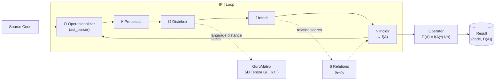

# Pacote de contexto — revisão do motor do TTM

## Resumo do projeto e regras em vigor

- **TTM (Teoria Tridimensional do Morfema):** analisa morfemas em três dimensões: largura (raiz e afixos), profundidade (camadas de sentido) e altura (diacríticos). O escopo do produto é o **árabe clássico/corânico** e o **hebraico bíblico**.
- **Motor em produção:** TypeScript, em `web/src/lib/ttm/`, servido pela API Next.js `POST /api/analyze` `{text, language}`. O motor Python (`ttm/`) só será comparado no S3.
- **Base atual:** 20 raízes árabes e 5 hebraicas, em `data/roots/`; o site usa uma cópia idêntica.
- **Conjunto de referência (S2.1, já aprovado):** 140 casos, sendo 80 árabes (40 cobertos, 20 fora da cobertura, 20 armadilhas) e 60 hebraicos (30, 15 e 15). O README e a linha de base estão no pacote.
- **Metas do S2.2:**
  - acerto exato nas formas de raízes cobertas: pelo menos 90%;
  - falsos positivos nas armadilhas: zero;
  - raízes inventadas fora da cobertura: zero.

  A comparação de raízes usa `normalize.mjs`, que preserva a distinção sin/shin.
- **Regras (pareceres aprovados):**
  - o motor não inventa raiz; sem evidência, a resposta é "raiz não identificada";
  - interpretação hermenêutica não é apresentada como significado lexical;
  - cada mudança vem numa PR pequena, com revisão independente;
  - nada de comparação com CAMeL Tools ou DictaBERT, nem de corpora inteiros, no S2.
- **Álgebra Hexarrelacional:** é do mesmo autor. A posição aprovada é usar a arquitetura (relações como camada de evidência rastreável) só se um experimento mostrar ganho contra o conjunto de referência. O operador Π, iterado, converge para 1 e não serve como métrica.

## Arquivos

## Parte 1 — TTM (marcabru-tech/teoria-tridimensional-morfema)

### `web/src/lib/ttm/types.ts`

Repositório: marcabru-tech/teoria-tridimensional-morfema · commit `7ab1003` · licença: CC BY-NC-SA 4.0 (dados de terceiros conforme README do conjunto)

```ts
export enum SemanticLevel {
  LITERAL = 1,
  ALLUSIVE = 2,
  HOMILETIC = 3,
  MYSTICAL = 4,
}

export interface SemanticLayer {
  level: SemanticLevel;
  levelName: string;
  meaning: string;
  tradition?: string;
}

export interface Diacritic {
  symbol: string;
  name: string;
  position: string;
}

export interface Width {
  root: string;
  prefixes: string[];
  suffixes: string[];
  pattern: string;
  derivationDegree: number;
  possibleDerivations: { form: string; gloss: string }[];
}

export interface Depth {
  currentLevel: number;
  semanticField: string;
  layers: SemanticLayer[];
}

export interface Height {
  baseForm: string;
  configurationId: number;
  vowels: string[];
  diacritics: Diacritic[];
  alternativeVocalizations: string[];
}

export interface MorphemeCoordinates {
  x: number;
  y: number;
  z: number;
}

export interface MorphemeAnalysis {
  morpheme: string;
  root: string;
  language: string;
  gloss: string;
  coordinates: MorphemeCoordinates;
  dimensions: {
    width: Width;
    depth: Depth;
    height: Height;
  };
}

export interface AnalysisRequest {
  text: string;
  language: string;
}

export interface AnalysisResponse {
  originalText: string;
  morpheme: MorphemeAnalysis;
}
```

### `web/src/lib/ttm/analyzer.ts`

Repositório: marcabru-tech/teoria-tridimensional-morfema · commit `7ab1003` · licença: CC BY-NC-SA 4.0 (dados de terceiros conforme README do conjunto)

```ts
import { AnalysisRequest, AnalysisResponse, MorphemeAnalysis } from './types';
import { analyzeArabic } from './arabic';
import { analyzeHebrew } from './hebrew';
import { analyzeGeneric } from './generic';

export function analyze(request: AnalysisRequest): AnalysisResponse {
  let morpheme: MorphemeAnalysis;
  
  switch (request.language) {
    case 'ar':
      morpheme = analyzeArabic(request.text);
      break;
    case 'he':
      morpheme = analyzeHebrew(request.text);
      break;
    default:
      morpheme = analyzeGeneric(request.text, request.language);
  }
  
  return {
    originalText: request.text,
    morpheme,
  };
}
```

### `web/src/lib/ttm/arabic.ts`

Repositório: marcabru-tech/teoria-tridimensional-morfema · commit `7ab1003` · licença: CC BY-NC-SA 4.0 (dados de terceiros conforme README do conjunto)

```ts
import arabicRoots from '@/data/roots/arabic_roots.json';
import { MorphemeAnalysis, SemanticLevel, Width, Depth, Height } from './types';

const ARABIC_DIACRITICS = /[\u0610-\u061a\u064b-\u065f\u0670\u06d6-\u06dc\u06df-\u06e4\u06e7\u06e8\u06ea-\u06ed]/g;

function stripDiacritics(text: string): string {
  return text.replace(ARABIC_DIACRITICS, '');
}

function extractDiacritics(text: string): string[] {
  return text.match(ARABIC_DIACRITICS) || [];
}

// A base é importada estaticamente para entrar no bundle da função serverless.
// Ler o arquivo em tempo de execução (fs + process.cwd()) falhava em silêncio
// quando data/ não acompanhava o deploy. Cópia sincronizada de data/roots/
// (ver scripts/check-data-sync.mjs).
const rootsData: Record<string, any> = arabicRoots;

function getRootsData() {
  return rootsData;
}

export function analyzeArabic(form: string): MorphemeAnalysis {
  const data = getRootsData() || {};
  const stripped = stripDiacritics(form);
  const diacriticsFound = extractDiacritics(form);
  
  // Try to find root in data
  let matchedRoot = '';
  let rootInfo: any = null;
  
  for (const [root, info] of Object.entries(data)) {
    const rootChars = root.replace(/-/g, '');
    if (stripped === rootChars || stripped.includes(rootChars) || rootChars.includes(stripped)) {
      matchedRoot = root;
      rootInfo = info;
      break;
    }
    // Check examples
    for (const exampleForm of Object.keys((info as any).examples || {})) {
      if (stripDiacritics(exampleForm) === stripped) {
        matchedRoot = root;
        rootInfo = info;
        break;
      }
    }
    if (rootInfo) break;
  }

  const root = matchedRoot || stripped.split('').join('-');
  const semanticField = rootInfo?.semantic_field || '';
  const description = rootInfo?.description || '';
  const examples = rootInfo?.examples || {};

  const derivations = Object.entries(examples).map(([f, g]) => ({ form: f, gloss: g as string }));

  const width: Width = {
    root,
    prefixes: [],
    suffixes: [],
    pattern: '',
    derivationDegree: matchedRoot ? 0 : 1,
    possibleDerivations: derivations,
  };

  // Build depth with semantic layers (Ẓāhir/Bāṭin tradition — four levels mirroring PaRDeS)
  const layers = [
    { level: SemanticLevel.LITERAL, levelName: 'Literal (Ẓāhir)', meaning: description || `Surface meaning of ${form}`, tradition: 'Islamic' },
    { level: SemanticLevel.ALLUSIVE, levelName: 'Allusive (Isharī)', meaning: semanticField ? `Field: ${semanticField}` : 'Allusive meaning', tradition: 'Sufi' },
    { level: SemanticLevel.HOMILETIC, levelName: 'Homiletic (Tafsīr)', meaning: 'Exegetical / commentarial dimension', tradition: 'Islamic' },
    { level: SemanticLevel.MYSTICAL, levelName: 'Mystical (Bāṭin)', meaning: 'Hidden / esoteric dimension', tradition: 'Sufi' },
  ];

  const depth: Depth = {
    currentLevel: 1,
    semanticField,
    layers,
  };

  const height: Height = {
    baseForm: stripped,
    configurationId: diacriticsFound.length,
    vowels: diacriticsFound,
    diacritics: diacriticsFound.map((d, i) => ({ symbol: d, name: `diacritic-${i + 1}`, position: 'above' })),
    alternativeVocalizations: derivations.slice(0, 3).map(d => d.form),
  };

  return {
    morpheme: form,
    root,
    language: 'ar',
    gloss: examples[form] || description || '',
    coordinates: { x: width.derivationDegree, y: depth.currentLevel, z: height.configurationId },
    dimensions: { width, depth, height },
  };
}
```

### `web/src/lib/ttm/hebrew.ts`

Repositório: marcabru-tech/teoria-tridimensional-morfema · commit `7ab1003` · licença: CC BY-NC-SA 4.0 (dados de terceiros conforme README do conjunto)

```ts
import hebrewRoots from '@/data/roots/hebrew_roots.json';
import { MorphemeAnalysis, SemanticLevel, Width, Depth, Height } from './types';

const HEBREW_NIQQUD = /[\u0591-\u05c7]/g;

function stripNiqqud(text: string): string {
  return text.replace(HEBREW_NIQQUD, '');
}

function extractNiqqud(text: string): string[] {
  return text.match(HEBREW_NIQQUD) || [];
}

// A base é importada estaticamente para entrar no bundle da função serverless.
// Ler o arquivo em tempo de execução (fs + process.cwd()) falhava em silêncio
// quando data/ não acompanhava o deploy. Cópia sincronizada de data/roots/
// (ver scripts/check-data-sync.mjs).
const rootsData: Record<string, any> = hebrewRoots;

function getRootsData() {
  return rootsData;
}

export function analyzeHebrew(form: string): MorphemeAnalysis {
  const data = getRootsData() || {};
  const stripped = stripNiqqud(form);
  const niqqudFound = extractNiqqud(form);
  
  let matchedRoot = '';
  let rootInfo: any = null;
  
  for (const [root, info] of Object.entries(data)) {
    const rootChars = root.replace(/-/g, '');
    if (stripped === rootChars) {
      matchedRoot = root;
      rootInfo = info;
      break;
    }
    for (const exampleForm of Object.keys((info as any).examples || {})) {
      if (stripNiqqud(exampleForm) === stripped) {
        matchedRoot = root;
        rootInfo = info;
        break;
      }
    }
    if (rootInfo) break;
  }

  const root = matchedRoot || stripped.split('').join('-');
  const semanticField = rootInfo?.semantic_field || '';
  const description = rootInfo?.description || '';
  const examples = rootInfo?.examples || {};

  const derivations = Object.entries(examples).map(([f, g]) => ({ form: f, gloss: g as string }));

  const width: Width = {
    root,
    prefixes: [],
    suffixes: [],
    pattern: '',
    derivationDegree: matchedRoot ? 0 : 1,
    possibleDerivations: derivations,
  };

  // Hebrew PaRDeS semantic levels
  const layers = [
    { level: SemanticLevel.LITERAL, levelName: 'Peshat (פשט)', meaning: description || `Literal meaning of ${form}`, tradition: 'Rabbinic' },
    { level: SemanticLevel.ALLUSIVE, levelName: 'Remez (רמז)', meaning: semanticField ? `Allegorical: ${semanticField}` : 'Allegorical meaning', tradition: 'Medieval' },
    { level: SemanticLevel.HOMILETIC, levelName: 'Derash (דרש)', meaning: 'Homiletical / midrashic dimension', tradition: 'Rabbinic' },
    { level: SemanticLevel.MYSTICAL, levelName: 'Sod (סוד)', meaning: 'Mystical / Kabbalistic dimension', tradition: 'Kabbalah' },
  ];

  const depth: Depth = {
    currentLevel: 1,
    semanticField,
    layers,
  };

  const height: Height = {
    baseForm: stripped,
    configurationId: niqqudFound.length,
    vowels: niqqudFound,
    diacritics: niqqudFound.map((d, i) => ({ symbol: d, name: `niqqud-${i + 1}`, position: 'below' })),
    alternativeVocalizations: derivations.slice(0, 3).map(d => d.form),
  };

  return {
    morpheme: form,
    root,
    language: 'he',
    gloss: examples[form] || description || '',
    coordinates: { x: width.derivationDegree, y: depth.currentLevel, z: height.configurationId },
    dimensions: { width, depth, height },
  };
}
```

### `web/src/lib/ttm/generic.ts`

Repositório: marcabru-tech/teoria-tridimensional-morfema · commit `7ab1003` · licença: CC BY-NC-SA 4.0 (dados de terceiros conforme README do conjunto)

```ts
import { MorphemeAnalysis, SemanticLevel, Width, Depth, Height } from './types';

export function analyzeGeneric(form: string, language: string): MorphemeAnalysis {
  const words = form.trim().split(/\s+/);
  const root = words[0].toLowerCase();
  
  const width: Width = {
    root,
    prefixes: [],
    suffixes: [],
    pattern: '',
    derivationDegree: words.length - 1,
    possibleDerivations: [],
  };

  const layers = [
    { level: SemanticLevel.LITERAL, levelName: 'Literal', meaning: `Surface form: ${form}`, tradition: 'General' },
    { level: SemanticLevel.ALLUSIVE, levelName: 'Figurative', meaning: 'Figurative / metaphorical use', tradition: 'General' },
    { level: SemanticLevel.HOMILETIC, levelName: 'Homiletic', meaning: 'Homiletical / applied meaning', tradition: 'General' },
    { level: SemanticLevel.MYSTICAL, levelName: 'Symbolic', meaning: 'Symbolic / archetypal meaning', tradition: 'General' },
  ];

  const depth: Depth = {
    currentLevel: 1,
    semanticField: 'general',
    layers,
  };

  const vowels = form.match(/[aeiouáéíóúàèìòùâêîôûãõ]/gi) || [];
  
  const height: Height = {
    baseForm: root,
    configurationId: vowels.length,
    vowels,
    diacritics: [],
    alternativeVocalizations: [],
  };

  return {
    morpheme: form,
    root,
    language,
    gloss: '',
    coordinates: { x: width.derivationDegree, y: depth.currentLevel, z: height.configurationId },
    dimensions: { width, depth, height },
  };
}
```

### `web/src/app/api/analyze/route.ts`

Repositório: marcabru-tech/teoria-tridimensional-morfema · commit `7ab1003` · licença: CC BY-NC-SA 4.0 (dados de terceiros conforme README do conjunto)

```ts
import { NextRequest, NextResponse } from 'next/server';
import { analyze } from '@/lib/ttm/analyzer';

export async function POST(request: NextRequest) {
  try {
    const body = await request.json();
    const { text, language } = body;
    
    if (!text || typeof text !== 'string' || text.trim().length === 0) {
      return NextResponse.json({ error: 'Text is required' }, { status: 400 });
    }
    
    if (!language || typeof language !== 'string') {
      return NextResponse.json({ error: 'Language is required' }, { status: 400 });
    }
    
    const result = analyze({ text: text.trim(), language });
    return NextResponse.json(result);
  } catch (error) {
    console.error('Analysis error:', error);
    return NextResponse.json({ error: 'Analysis failed' }, { status: 500 });
  }
}
```

### `data/roots/arabic_roots.json`

Repositório: marcabru-tech/teoria-tridimensional-morfema · commit `7ab1003` · licença: CC BY-NC-SA 4.0 (dados de terceiros conforme README do conjunto)

```json
{
    "ك-ت-ب": {
        "semantic_field": "escrita",
        "frequency": "very_high",
        "description": "Writing, recording, prescribing",
        "examples": {
            "كَتَبَ": "he wrote",
            "كَاتِب": "writer",
            "مَكْتُوب": "written / fate (destino)",
            "كِتَاب": "book",
            "مَكْتَبَة": "library",
            "كُتُب": "books",
            "كِتَابَة": "writing (act of)",
            "مَكْتَب": "office / desk"
        }
    },
    "ق-ر-أ": {
        "semantic_field": "leitura",
        "frequency": "very_high",
        "description": "Reading, reciting",
        "examples": {
            "قَرَأَ": "he read",
            "قَارِئ": "reader",
            "قُرْآن": "Quran (recitation)",
            "قِرَاءَة": "reading (act of)"
        }
    },
    "ع-ل-م": {
        "semantic_field": "conhecimento",
        "frequency": "very_high",
        "description": "Knowledge, learning, teaching",
        "examples": {
            "عَلِمَ": "he knew",
            "عَالِم": "scholar / knowledgeable",
            "مَعْلُوم": "known",
            "عِلْم": "knowledge / science",
            "مُعَلِّم": "teacher",
            "تَعَلَّمَ": "he learned"
        }
    },
    "ف-ع-ل": {
        "semantic_field": "ação",
        "frequency": "very_high",
        "description": "Doing, action, effect",
        "examples": {
            "فَعَلَ": "he did",
            "فَاعِل": "doer / agent",
            "مَفْعُول": "done / object",
            "فِعْل": "action / verb"
        }
    },
    "د-ر-س": {
        "semantic_field": "estudo",
        "frequency": "high",
        "description": "Studying, teaching, lessons",
        "examples": {
            "دَرَسَ": "he studied",
            "دَارِس": "student",
            "مَدْرَسَة": "school",
            "دَرْس": "lesson",
            "مُدَرِّس": "teacher"
        }
    },
    "ح-م-د": {
        "semantic_field": "louvor",
        "frequency": "very_high",
        "description": "Praising, thanking",
        "examples": {
            "حَمِدَ": "he praised",
            "حَامِد": "one who praises",
            "مَحْمُود": "praised / praiseworthy",
            "حَمْد": "praise",
            "مُحَمَّد": "Muhammad (greatly praised)",
            "أَحْمَد": "Ahmad (most praised)"
        }
    },
    "س-ل-م": {
        "semantic_field": "paz",
        "frequency": "very_high",
        "description": "Peace, submission, safety",
        "examples": {
            "سَلِمَ": "he was safe",
            "سَالِم": "safe / sound",
            "مُسْلِم": "Muslim (one who submits)",
            "سَلَام": "peace",
            "إِسْلَام": "Islam (submission)",
            "تَسْلِيم": "surrender / delivery"
        }
    },
    "ف-ت-ح": {
        "semantic_field": "abertura",
        "frequency": "high",
        "description": "Opening, conquering, initiating",
        "examples": {
            "فَتَحَ": "he opened",
            "فَاتِح": "opener / conqueror",
            "مَفْتُوح": "opened",
            "فَتْح": "conquest / opening",
            "مِفْتَاح": "key"
        }
    },
    "ج-م-ع": {
        "semantic_field": "reunião",
        "frequency": "high",
        "description": "Gathering, collecting, assembling",
        "examples": {
            "جَمَعَ": "he gathered",
            "جَامِع": "gatherer / mosque",
            "مَجْمُوع": "collected / total",
            "جَمْع": "gathering / plural",
            "جَامِعَة": "university"
        }
    },
    "ن-ز-ل": {
        "semantic_field": "descida",
        "frequency": "high",
        "description": "Descending, sending down, revelation",
        "examples": {
            "نَزَلَ": "he descended",
            "نَازِل": "descending",
            "مَنْزِل": "house / station",
            "نُزُول": "descent",
            "تَنْزِيل": "revelation / sending down"
        }
    },
    "خ-ل-ق": {
        "semantic_field": "criação",
        "frequency": "high",
        "description": "Creating, making, character",
        "examples": {
            "خَلَقَ": "he created",
            "خَالِق": "creator",
            "مَخْلُوق": "creature / created being",
            "خَلْق": "creation",
            "أَخْلَاق": "ethics / morals"
        }
    },
    "ع-ب-د": {
        "semantic_field": "adoração",
        "frequency": "very_high",
        "description": "Worshipping, serving, slavery",
        "examples": {
            "عَبَدَ": "he worshipped",
            "عَابِد": "worshipper",
            "عَبْد": "servant / slave",
            "عِبَادَة": "worship",
            "مَعْبَد": "temple"
        }
    },
    "ر-ح-م": {
        "semantic_field": "misericórdia",
        "frequency": "very_high",
        "description": "Showing mercy, compassion",
        "examples": {
            "رَحِمَ": "he showed mercy",
            "رَاحِم": "merciful",
            "رَحْمَة": "mercy",
            "رَحِيم": "most merciful",
            "رَحْمَان": "most compassionate"
        }
    },
    "ش-ه-د": {
        "semantic_field": "testemunho",
        "frequency": "high",
        "description": "Witnessing, testifying, martyrdom",
        "examples": {
            "شَهِدَ": "he witnessed",
            "شَاهِد": "witness",
            "مَشْهُود": "witnessed",
            "شَهَادَة": "testimony / certificate",
            "شَهِيد": "martyr"
        }
    },
    "و-ح-د": {
        "semantic_field": "unidade",
        "frequency": "high",
        "description": "Unity, oneness, uniqueness",
        "examples": {
            "وَحَّدَ": "he unified",
            "وَاحِد": "one / single",
            "تَوْحِيد": "monotheism / unification",
            "وَحْدَة": "unity / unit"
        }
    },
    "ن-ص-ر": {
        "semantic_field": "vitória",
        "frequency": "high",
        "description": "Helping, victory, support",
        "examples": {
            "نَصَرَ": "he helped / he was victorious",
            "نَاصِر": "helper / supporter",
            "مَنْصُور": "victorious",
            "نَصْر": "victory / help"
        }
    },
    "ح-ك-م": {
        "semantic_field": "julgamento",
        "frequency": "high",
        "description": "Judging, ruling, wisdom",
        "examples": {
            "حَكَمَ": "he judged / he ruled",
            "حَاكِم": "judge / ruler",
            "حُكْم": "ruling / judgment",
            "حَكِيم": "wise",
            "حِكْمَة": "wisdom"
        }
    },
    "ص-ل-ح": {
        "semantic_field": "retidão",
        "frequency": "high",
        "description": "Being good, reform, reconciliation",
        "examples": {
            "صَلُحَ": "he was good / righteous",
            "صَالِح": "righteous / good",
            "إِصْلَاح": "reform",
            "مُصْلِح": "reformer",
            "صُلْح": "peace / reconciliation"
        }
    },
    "ذ-ك-ر": {
        "semantic_field": "lembrança",
        "frequency": "high",
        "description": "Remembering, mentioning, male",
        "examples": {
            "ذَكَرَ": "he remembered / he mentioned",
            "ذَاكِر": "one who remembers",
            "ذِكْر": "remembrance / mention",
            "تَذْكِيرَة": "reminder / ticket",
            "ذَكَر": "male"
        }
    },
    "ج-ه-د": {
        "semantic_field": "esforço",
        "frequency": "high",
        "description": "Striving, effort, struggle",
        "examples": {
            "جَاهَدَ": "he strove / he struggled",
            "مُجَاهِد": "striver / fighter",
            "جِهَاد": "striving / struggle",
            "اِجْتِهَاد": "diligent effort / legal reasoning"
        }
    }
}
```

### `data/roots/hebrew_roots.json`

Repositório: marcabru-tech/teoria-tridimensional-morfema · commit `7ab1003` · licença: CC BY-NC-SA 4.0 (dados de terceiros conforme README do conjunto)

```json
{
    "מ-ל-ך": {
        "semantic_field": "soberania",
        "frequency": "very_high",
        "description": "Ruling, king, royalty",
        "examples": {
            "מָלַךְ": "he ruled",
            "מֶלֶךְ": "king",
            "מַלְכָּה": "queen",
            "מַלְכוּת": "kingdom / kingship",
            "מַמְלָכָה": "kingdom (territory)"
        }
    },
    "שׁ-מ-ר": {
        "semantic_field": "proteção",
        "frequency": "very_high",
        "description": "Guarding, keeping, observing",
        "examples": {
            "שָׁמַר": "he guarded / he kept",
            "שׁוֹמֵר": "guard / keeper",
            "מִשְׁמָר": "guard (act) / shift",
            "שְׁמִירָה": "guarding / keeping"
        }
    },
    "כ-ת-ב": {
        "semantic_field": "escrita",
        "frequency": "high",
        "description": "Writing",
        "examples": {
            "כָּתַב": "he wrote",
            "כּוֹתֵב": "writer",
            "מִכְתָּב": "letter",
            "כְּתָב": "writing / script",
            "כְּתֻבָּה": "ketubah (marriage contract)"
        }
    },
    "א-ה-ב": {
        "semantic_field": "amor",
        "frequency": "high",
        "description": "Loving",
        "examples": {
            "אָהַב": "he loved",
            "אוֹהֵב": "lover / loving",
            "אַהֲבָה": "love",
            "אָהוּב": "beloved"
        }
    },
    "ב-ר-א": {
        "semantic_field": "criação",
        "frequency": "high",
        "description": "Creating (ex nihilo)",
        "examples": {
            "בָּרָא": "he created",
            "בּוֹרֵא": "creator",
            "בְּרִיאָה": "creation"
        }
    }
}
```

### `ttm/analyzers/base.py`

Repositório: marcabru-tech/teoria-tridimensional-morfema · commit `7ab1003` · licença: CC BY-NC-SA 4.0 (dados de terceiros conforme README do conjunto)

```python
"""
Abstract base class for language-specific analyzers.
"""

from __future__ import annotations

from abc import ABC, abstractmethod
from typing import List

from ttm.core.morpheme import Morpheme
from ttm.core.space import RootSpace


class LanguageAnalyzer(ABC):
    """Abstract interface for language-specific morphological analysis.

    All language analyzers must implement these methods to integrate
    with the TTM framework.
    """

    @abstractmethod
    def analyze_root(self, root: str) -> RootSpace:
        """Analyze a root and return a space of its derivations.

        Args:
            root: The consonantal root (e.g. 'ك-ت-ب', 'מ-ל-כ').

        Returns:
            A RootSpace populated with derived morphemes.
        """

    @abstractmethod
    def parse_morpheme(self, form: str) -> Morpheme:
        """Parse a surface form into a Morpheme.

        Args:
            form: The surface form to parse.

        Returns:
            A Morpheme with populated dimensions.
        """

    @abstractmethod
    def vocalize(self, form: str) -> List[str]:
        """Generate possible vocalizations for an unvocalized form.

        Args:
            form: The unvocalized form.

        Returns:
            List of possible vocalized forms.
        """

    @abstractmethod
    def get_language_code(self) -> str:
        """Return the ISO 639 language code.

        Returns:
            Language code string.
        """
```

### `ttm/analyzers/arabic.py`

Repositório: marcabru-tech/teoria-tridimensional-morfema · commit `7ab1003` · licença: CC BY-NC-SA 4.0 (dados de terceiros conforme README do conjunto)

```python
"""
Arabic morphological analyzer.

Implements root extraction, pattern matching, and derivation generation
for the Arabic trilateral root system.
"""

from __future__ import annotations

import json
import os
import re
from typing import Dict, List, Optional

from ttm.analyzers.base import LanguageAnalyzer
from ttm.core.dimensions import Depth, Height, SemanticLevel, Width
from ttm.core.morpheme import Morpheme
from ttm.core.space import RootSpace

# Arabic diacritics Unicode range
ARABIC_DIACRITICS = re.compile(
    "[\u0610-\u061a\u064b-\u065f\u0670\u06d6-\u06dc\u06df-\u06e4\u06e7\u06e8\u06ea-\u06ed]"
)

# Standard Arabic derivational patterns (awzān)
ARABIC_PATTERNS: Dict[str, Dict] = {
    "فَعَلَ": {
        "type": "verb",
        "form": "I",
        "template": "1a2a3a",
        "aspect": "perfective",
        "voice": "active",
        "description": "Form I perfective active",
    },
    "فَعِلَ": {
        "type": "verb",
        "form": "I",
        "template": "1a2i3a",
        "aspect": "perfective",
        "voice": "active",
        "description": "Form I perfective active (medial kasra)",
    },
    "فَاعِل": {
        "type": "noun",
        "form": "I",
        "template": "1aa2i3",
        "category": "active_participle",
        "description": "Active participle (Form I)",
    },
    "مَفْعُول": {
        "type": "noun",
        "form": "I",
        "template": "ma12uu3",
        "category": "passive_participle",
        "description": "Passive participle (Form I)",
    },
    "فِعَال": {
        "type": "noun",
        "form": "I",
        "template": "1i2aa3",
        "category": "verbal_noun",
        "description": "Verbal noun (Form I, pattern فِعَال)",
    },
    "فِعَالَة": {
        "type": "noun",
        "form": "I",
        "template": "1i2aa3a",
        "category": "verbal_noun",
        "description": "Verbal noun (Form I, pattern فِعَالَة)",
    },
    "فُعُول": {
        "type": "noun",
        "form": "I",
        "template": "1u2uu3",
        "category": "plural",
        "description": "Broken plural (pattern فُعُول)",
    },
    "كُتُب": {
        "type": "noun",
        "form": "I",
        "template": "1u2u3",
        "category": "plural",
        "description": "Broken plural (pattern فُعُل)",
    },
    "مَفْعَل": {
        "type": "noun",
        "form": "I",
        "template": "ma12a3",
        "category": "noun_of_place",
        "description": "Noun of place/time (Form I)",
    },
    "مَفْعَلَة": {
        "type": "noun",
        "form": "I",
        "template": "ma12a3a",
        "category": "noun_of_place",
        "description": "Noun of place (feminine, Form I)",
    },
}


def strip_diacritics(text: str) -> str:
    """Remove Arabic diacritical marks from text.

    Args:
        text: Arabic text with potential diacritics.

    Returns:
        Text with diacritics removed.
    """
    return ARABIC_DIACRITICS.sub("", text)


def extract_diacritics(text: str) -> List[str]:
    """Extract all diacritical marks from Arabic text.

    Args:
        text: Arabic text.

    Returns:
        List of diacritic characters found.
    """
    return ARABIC_DIACRITICS.findall(text)


class ArabicAnalyzer(LanguageAnalyzer):
    """Morphological analyzer for Arabic.

    Supports trilateral root extraction, pattern identification,
    and generation of derivations.
    """

    def __init__(self, data_path: Optional[str] = None):
        """Initialize the Arabic analyzer.

        Args:
            data_path: Optional path to arabic_roots.json data file.
        """
        self._roots_data: Dict = {}
        if data_path and os.path.exists(data_path):
            self._load_data(data_path)
        else:
            default_path = os.path.join(
                os.path.dirname(os.path.dirname(os.path.dirname(__file__))),
                "data",
                "roots",
                "arabic_roots.json",
            )
            if os.path.exists(default_path):
                self._load_data(default_path)

    def _load_data(self, path: str) -> None:
        """Load roots data from JSON file."""
        with open(path, "r", encoding="utf-8") as f:
            self._roots_data = json.load(f)

    def get_language_code(self) -> str:
        return "ar"

    def analyze_root(self, root: str) -> RootSpace:
        """Analyze an Arabic root and build a RootSpace with its derivations.

        Args:
            root: Trilateral root in format 'ف-ع-ل' or 'فعل'.

        Returns:
            RootSpace populated with known derivations.
        """
        normalized = root.replace("-", "").replace(" ", "")
        display_root = "-".join(normalized) if "-" not in root else root

        space = RootSpace(root=display_root, language="ar")

        root_info = self._roots_data.get(display_root, {})
        semantic_field = root_info.get("semantic_field", "")
        examples = root_info.get("examples", {})

        config_id = 0
        for form_text, gloss in examples.items():
            config_id += 1
            stripped = strip_diacritics(form_text)
            diacritics_found = extract_diacritics(form_text)

            width = Width(
                root=display_root,
                derivation_degree=0 if stripped == normalized else 1,
            )

            depth = Depth(semantic_field=semantic_field)
            depth.add_layer(level=SemanticLevel.LITERAL, meaning=gloss)

            height = Height(
                base_form=stripped,
                configuration_id=config_id,
                vowels=[d for d in diacritics_found],
            )

            morpheme = Morpheme(
                form=form_text,
                root=display_root,
                language="ar",
                gloss=gloss,
                x=width,
                y=depth,
                z=height,
            )
            space.add_morpheme(morpheme)

        return space

    def parse_morpheme(self, form: str) -> Morpheme:
        """Parse an Arabic word into a Morpheme.

        Args:
            form: Arabic word (vocalized or unvocalized).

        Returns:
            A Morpheme with basic dimensional analysis.
        """
        stripped = strip_diacritics(form)
        diacritics_found = extract_diacritics(form)

        width = Width(root=stripped)
        depth = Depth()
        height = Height(
            base_form=stripped,
            configuration_id=len(diacritics_found),
            vowels=diacritics_found,
        )

        return Morpheme(
            form=form,
            root=stripped,
            language="ar",
            x=width,
            y=depth,
            z=height,
        )

    def vocalize(self, form: str) -> List[str]:
        """Return known vocalizations for an unvocalized Arabic form.

        Args:
            form: Unvocalized Arabic form.

        Returns:
            List of known vocalized forms.
        """
        stripped = strip_diacritics(form)
        vocalizations = []
        for root_key, root_data in self._roots_data.items():
            for vocalized_form in root_data.get("examples", {}):
                if strip_diacritics(vocalized_form) == stripped:
                    vocalizations.append(vocalized_form)
        return vocalizations

    def get_root_info(self, root: str) -> Optional[Dict]:
        """Get stored data for a root.

        Args:
            root: Root in 'ف-ع-ل' format.

        Returns:
            Root data dictionary or None.
        """
        return self._roots_data.get(root)
```

### `ttm/analyzers/hebrew.py`

Repositório: marcabru-tech/teoria-tridimensional-morfema · commit `7ab1003` · licença: CC BY-NC-SA 4.0 (dados de terceiros conforme README do conjunto)

```python
"""
Hebrew morphological analyzer.

Implements root extraction and deviation generation for the Hebrew root system.
"""

from __future__ import annotations

import json
import os
import re
from typing import Dict, List, Optional

from ttm.analyzers.base import LanguageAnalyzer
from ttm.core.dimensions import Depth, Height, SemanticLevel, Width
from ttm.core.morpheme import Morpheme
from ttm.core.space import RootSpace

# Hebrew niqqud (points) Unicode range
HEBREW_NIQQUD = re.compile("[\u0591-\u05c7]")


def strip_niqqud(text: str) -> str:
    """Remove Hebrew niqqud marks from text."""
    return HEBREW_NIQQUD.sub("", text)


def extract_niqqud(text: str) -> List[str]:
    """Extract all niqqud marks from Hebrew text."""
    return HEBREW_NIQQUD.findall(text)


class HebrewAnalyzer(LanguageAnalyzer):
    """Morphological analyzer for Hebrew."""

    def __init__(self, data_path: Optional[str] = None):
        """Initialize the Hebrew analyzer.

        Args:
            data_path: Optional path to hebrew_roots.json data file.
        """
        self._roots_data: Dict = {}
        if data_path and os.path.exists(data_path):
            self._load_data(data_path)
        else:
            default_path = os.path.join(
                os.path.dirname(os.path.dirname(os.path.dirname(__file__))),
                "data",
                "roots",
                "hebrew_roots.json",
            )
            if os.path.exists(default_path):
                self._load_data(default_path)

    def _load_data(self, path: str) -> None:
        """Load roots data from JSON file."""
        with open(path, "r", encoding="utf-8") as f:
            self._roots_data = json.load(f)

    def get_language_code(self) -> str:
        return "he"

    def analyze_root(self, root: str) -> RootSpace:
        """Analyze a Hebrew root and build a RootSpace.

        Args:
            root: Root in 'מ-ל-ך' format.

        Returns:
            RootSpace populated with derivations.
        """
        normalized = root.replace("-", "").replace(" ", "")
        display_root = "-".join(normalized) if "-" not in root else root

        space = RootSpace(root=display_root, language="he")

        root_info = self._roots_data.get(display_root, {})
        semantic_field = root_info.get("semantic_field", "")
        examples = root_info.get("examples", {})

        config_id = 0
        for form_text, gloss in examples.items():
            config_id += 1
            stripped = strip_niqqud(form_text)
            niqqud_found = extract_niqqud(form_text)

            width = Width(
                root=display_root,
                derivation_degree=0 if stripped == normalized else 1,
            )

            depth = Depth(semantic_field=semantic_field)
            depth.add_layer(level=SemanticLevel.LITERAL, meaning=gloss)

            height = Height(
                base_form=stripped,
                configuration_id=config_id,
                vowels=[d for d in niqqud_found],
            )

            morpheme = Morpheme(
                form=form_text,
                root=display_root,
                language="he",
                gloss=gloss,
                x=width,
                y=depth,
                z=height,
            )
            space.add_morpheme(morpheme)

        return space

    def parse_morpheme(self, form: str) -> Morpheme:
        """Parse a Hebrew word into a Morpheme."""
        stripped = strip_niqqud(form)
        niqqud_found = extract_niqqud(form)

        width = Width(root=stripped)
        depth = Depth()
        height = Height(
            base_form=stripped,
            configuration_id=len(niqqud_found),
            vowels=niqqud_found,
        )

        return Morpheme(
            form=form,
            root=stripped,
            language="he",
            x=width,
            y=depth,
            z=height,
        )

    def vocalize(self, form: str) -> List[str]:
        """Return known vocalizations for an unvocalized Hebrew form."""
        stripped = strip_niqqud(form)
        vocalizations = []
        for root_key, root_data in self._roots_data.items():
            for vocalized_form in root_data.get("examples", {}):
                if strip_niqqud(vocalized_form) == stripped:
                    vocalizations.append(vocalized_form)
        return vocalizations
```

### `web/tests/reference/README.md`

Repositório: marcabru-tech/teoria-tridimensional-morfema · commit `7ab1003` · licença: CC BY-NC-SA 4.0 (dados de terceiros conforme README do conjunto)

````markdown
# Conjunto de referência do TTM (S2.1)

Casos com fonte para medir o motor morfológico do TTM em **árabe corânico** e **hebraico bíblico**.
É uma linha de base inicial (140 casos). Não prova que o analisador domina essas variedades.

| Arquivo | Casos | Cobertas | Fora da cobertura | Armadilhas |
| --- | --- | --- | --- | --- |
| `ar.json` | 80 | 40 | 20 | 20 |
| `he.json` | 60 | 30 | 15 | 15 |

## Categorias

- **coberta**: forma de uma raiz presente na base do TTM. O motor deve devolver essa raiz.
- **fora_da_cobertura**: forma legítima de uma raiz ausente da base. O motor deve devolver "raiz não identificada".
- **armadilha**: forma que contém letras de uma raiz coberta, em sequência, contida nela ou como anagrama, sem pertencer a ela. Qualquer raiz coberta devolvida é falso positivo.

A categoria e a saída esperada de cada caso foram definidas antes de avaliar o motor.

## Campos de cada caso

- `attested_form`: a forma exatamente como está na fonte, sem alteração.
- `input`: o que é enviado ao motor. Quando difere da forma atestada, `input_derivation` explica a diferença. No hebraico, só são removidos os separadores de morfema `/` do OSHB.
- `expected`: a raiz esperada e a saída esperada.
- `reference_root`: a raiz segundo a fonte lexical, também nos casos fora da cobertura e nas armadilhas.
- `source`: corpus, localização exata, versão e licença.
- `root_evidence`: de onde vem a raiz esperada.
- `review`: quem propôs e quem revisou o caso. Guilherme revisa o conjunto inteiro antes do S2.2.

## Fontes e licenças

| Fonte | Uso | Versão | Licença |
| --- | --- | --- | --- |
| [Tanzil](https://tanzil.net) | formas árabes, copiadas literalmente | Tanzil Quran Text (Simple Clean, Version 1.1), via espelho [OpenITI/0025AH](https://github.com/OpenITI/0025AH) no commit `05bfb1c` | Creative Commons Attribution 3.0; cópia literal permitida, alteração proibida, citar o Tanzil e linkar tanzil.net |
| [Open Scriptures Hebrew Bible](https://github.com/openscriptures/morphhb) | formas hebraicas, lemas e morfologia | `morphhb@3d15126` | CC BY 4.0 |
| [Open Scriptures Hebrew Lexicon](https://github.com/openscriptures/HebrewLexicon) | raiz hebraica, pela cadeia Strong → BDB do `LexicalIndex.xml` | `HebrewLexicon@21c9add` | CC BY 4.0 (texto de BDB e Strong em domínio público) |
| Lane, *An Arabic-English Lexicon* (1863–1893) | raiz árabe, citada pelo verbete da edição impressa | — | domínio público; nenhuma edição digital foi usada |
| [Quranic Arabic Corpus](https://corpus.quran.com) 0.4 | só conferência, pela localização da palavra | — | GNU GPL, uso não comercial e só cópia literal: **nenhum dado foi copiado** |

**Atribuições exigidas:**

- Texto corânico: Tanzil Project (https://tanzil.net), Tanzil Quran Text (Simple Clean, Version 1.1), Copyright (C) 2007-2021 Tanzil Project, Creative Commons Attribution 3.0. As formas foram copiadas literalmente, sem alteração. Atualizações em https://tanzil.net/updates/.
- Original work of the Open Scriptures Hebrew Bible available at https://github.com/openscriptures/morphhb.
- Open Scriptures Hebrew Lexicon, Open Scriptures Hebrew Bible Project, https://github.com/openscriptures/HebrewLexicon.

## Observações de método

- **Localização no árabe:** `location` é sura:versículo, e `word` é a posição da palavra no texto Simple Clean. A leitura do espelho OpenITI:
  - junta as linhas de continuação (`~~`);
  - ignora os 253 marcadores de página (`ms…`), inclusive os que aparecem no cabeçalho do versículo;
  - descarta a basmala que esta cópia prefixa ao versículo 1 das suras 2 a 114.

  O resultado são 6.236 versículos.
- **Posição no Quranic Arabic Corpus:** fica em `root_evidence.cross_check.location`. É a posição no Simple Clean menos uma para cada «يا» anterior no versículo, porque no texto uthmânico do corpus «يا» vem unido à palavra seguinte. Uma amostra de 28 páginas do corpus foi conferida na revisão.
- **Raiz no hebraico:** a raiz vem do OSHB (lema Strong aumentado) ligado ao `LexicalIndex.xml`, seguindo a etimologia até a entrada de raiz do BDB. Homônimos de mesma raiz, como ברא I e ברא II, ficaram fora das formas cobertas. Os casos fora da cobertura são só verbos, porque partículas e alguns substantivos têm raiz conjectural no BDB.
- **Posição no hebraico:** `word` conta todos os `<w>` do versículo no OSHB, incluindo o qere que fica dentro de `<note>`. O `oshb_id` identifica a palavra sem ambiguidade.
- **Comparação de raízes:** o avaliador (`normalize.mjs`) remove hífens, diacríticos árabes e sinais hebraicos, mas **preserva a distinção entre sin (שׂ) e shin (שׁ)**. ש sem ponto conta como shin, que é a convenção da base.
- **Casos retirados na revisão:**
  - `فعلي` (11:35) também se lê *fiʿlī* ("meu ato"), da própria raiz ف-ع-ل.
  - `בָרָא` (2Sm 12:17) é tratado como homônimo de ברא por parte dos léxicos.
  - `ב/מלכן` (2Sm 12:31) é um ketiv sem vogais e de raiz disputada.
  - `מַשְׂמְרוֹת` (Ecl 12:11, antigo `he-059`), retirado no parecer da Luna. O BDB liga a forma a מַסְמֵר ("prego", com samekh) e marca a conexão etimológica como duvidosa, embora a forma seja grafada com sin. Um caso de sin/shin precisa de raiz de referência segura antes de entrar na avaliação.

  Os três hebraicos estão listados em `excluded` no `he.json`.

## Como rodar

Com o site rodando (`npm run build && npm run start`), dentro de `web/`:

```bash
node tests/reference/evaluate.mjs http://localhost:3000 --report tests/reference/linha-de-base.md
```

Sem `--enforce`, o script sempre termina com sucesso: ele registra a linha de base. A partir do S2.2, `--enforce` falha se alguma meta não for atingida:

- acerto exato nas cobertas: pelo menos 90%;
- falsos positivos nas armadilhas: 0;
- raízes inventadas fora da cobertura: 0.

O relatório do motor atual, antes de qualquer correção, está em `linha-de-base.md`.

## Testes do próprio conjunto

```bash
node --test tests/reference/normalize.test.mjs            # normalização (inclui sin/shin) e argumentos do avaliador
cd tests/reference/tools && python3 -m unittest test_he_build   # construtor hebraico com tokens sem morfologia
```

Os dois rodam no CI, no job `web`.
````

### `web/tests/reference/normalize.mjs`

Repositório: marcabru-tech/teoria-tridimensional-morfema · commit `7ab1003` · licença: CC BY-NC-SA 4.0 (dados de terceiros conforme README do conjunto)

```js
/**
 * Normalização de raízes para comparar a saída do motor com o conjunto de referência.
 *
 * - Remove hífens, diacríticos árabes e sinais hebraicos (vogais, cantilação, dagesh).
 * - Preserva a distinção entre sin e shin: שׂ (ponto à esquerda, U+05C2) vira o
 *   marcador "שׂ"; ש com ponto de shin (U+05C1) ou sem ponto conta como shin, que é a
 *   convenção da base do TTM (שׁ-מ-ר).
 * - Converte as letras finais hebraicas para a forma medial.
 */
const ARABIC_MARKS = /[ؐ-ًؚ-ٰٟۖ-ۜ۟-۪ۤۧۨ-ۭ]/g;
// Sinais hebraicos, exceto os pontos de shin (U+05C1) e sin (U+05C2), tratados à parte.
const HEBREW_MARKS = /[֑-׀׃-ׇ]/g;
const FINALS = { 'ך': 'כ', 'ם': 'מ', 'ן': 'נ', 'ף': 'פ', 'ץ': 'צ' };
const SIN = 'שׂ';

export function normRoot(r) {
  if (!r) return '';
  return r
    .replace(/-/g, '')
    .replace(ARABIC_MARKS, '')
    .replace(HEBREW_MARKS, '')
    // ש seguido do ponto de sin (com outros sinais já removidos entre eles) => sin
    .replace(/שׂ/g, SIN)
    // ponto de shin explícito => ש simples (shin é o padrão)
    .replace(/שׁ/g, 'ש')
    // pontos soltos que sobrarem (fora de ש) não têm valor distintivo
    .replace(/[ׁׂ]/g, (m, offset, s) => (s[offset - 1] === 'ש' ? m : ''))
    .replace(/[ךםןףץ]/g, (c) => FINALS[c]);
}
```

### `web/tests/reference/linha-de-base.md`

Repositório: marcabru-tech/teoria-tridimensional-morfema · commit `7ab1003` · licença: CC BY-NC-SA 4.0 (dados de terceiros conforme README do conjunto)

```markdown
# Relatório do conjunto de referência do TTM

Motor avaliado: `main` no commit `f8ac7fa` (antes de qualquer correção do S2), servidor local, `POST /api/analyze`. Gerado em 23/10/2026.

| Língua | Acerto exato nas cobertas (meta ≥ 90%) | Falsos positivos nas armadilhas (meta 0) | Raízes inventadas fora da cobertura (meta 0) |
| --- | --- | --- | --- |
| Árabe corânico | 38/40 (95.0%) | 14/20 | 20/20 |
| Hebraico bíblico | 11/30 (36.7%) | 0/15 | 15/15 |

Nas armadilhas, uma raiz devolvida que não pertence à base também aparece na lista de falhas como raiz inventada, mas só a raiz coberta conta como falso positivo.

## Árabe corânico: casos que falharam (42 de 80)

| Caso | Categoria | Entrada | Localização | Esperado | Obtido |
| --- | --- | --- | --- | --- | --- |
| ar-004 | coberta | القرآن | 2:185 | ق-ر-أ | devolveu ا-ل-ق-ر-آ-ن |
| ar-040 | coberta | جاهدوا | 3:142 | ج-ه-د | devolveu ج-ا-ه-د-و-ا |
| ar-041 | fora_da_cobertura | يؤمنون | 2:3 | raiz não identificada | raiz inventada: ي-ؤ-م-ن-و-ن |
| ar-042 | fora_da_cobertura | ويقيمون | 2:3 | raiz não identificada | raiz inventada: و-ي-ق-ي-م-و-ن |
| ar-043 | fora_da_cobertura | رزقناهم | 2:3 | raiz não identificada | raiz inventada: ر-ز-ق-ن-ا-ه-م |
| ar-044 | fora_da_cobertura | ينفقون | 2:3 | raiz não identificada | raiz inventada: ي-ن-ف-ق-و-ن |
| ar-045 | fora_da_cobertura | يوقنون | 2:4 | raiz não identificada | raiz inventada: ي-و-ق-ن-و-ن |
| ar-046 | fora_da_cobertura | المفلحون | 2:5 | raiz não identificada | raiz inventada: ا-ل-م-ف-ل-ح-و-ن |
| ar-047 | fora_da_cobertura | كفروا | 2:6 | raiz não identificada | raiz inventada: ك-ف-ر-و-ا |
| ar-048 | fora_da_cobertura | قلوبهم | 2:7 | raiz não identificada | raiz inventada: ق-ل-و-ب-ه-م |
| ar-049 | fora_da_cobertura | عذاب | 2:7 | raiz não identificada | raiz inventada: ع-ذ-ا-ب |
| ar-050 | fora_da_cobertura | يقول | 2:8 | raiz não identificada | raiz inventada: ي-ق-و-ل |
| ar-051 | fora_da_cobertura | يخادعون | 2:9 | raiz não identificada | raiz inventada: ي-خ-ا-د-ع-و-ن |
| ar-052 | fora_da_cobertura | مرض | 2:10 | raiz não identificada | raiz inventada: م-ر-ض |
| ar-053 | fora_da_cobertura | يكذبون | 2:10 | raiz não identificada | raiz inventada: ي-ك-ذ-ب-و-ن |
| ar-054 | fora_da_cobertura | تفسدوا | 2:11 | raiz não identificada | raiz inventada: ت-ف-س-د-و-ا |
| ar-055 | fora_da_cobertura | الأرض | 2:11 | raiz não identificada | raiz inventada: ا-ل-أ-ر-ض |
| ar-056 | fora_da_cobertura | السفهاء | 2:13 | raiz não identificada | raiz inventada: ا-ل-س-ف-ه-ا-ء |
| ar-057 | fora_da_cobertura | اشتروا | 2:16 | raiz não identificada | raiz inventada: ا-ش-ت-ر-و-ا |
| ar-058 | fora_da_cobertura | الضلالة | 2:16 | raiz não identificada | raiz inventada: ا-ل-ض-ل-ا-ل-ة |
| ar-059 | fora_da_cobertura | نورهم | 57:12 | raiz não identificada | raiz inventada: ن-و-ر-ه-م |
| ar-060 | fora_da_cobertura | ظلمات | 2:17 | raiz não identificada | raiz inventada: ظ-ل-م-ا-ت |
| ar-061 | armadilha | فعليها | 6:104 | raiz não identificada | falso positivo: ف-ع-ل |
| ar-062 | armadilha | فعليه | 10:84 | raiz não identificada | falso positivo: ف-ع-ل |
| ar-063 | armadilha | فعليكم | 8:72 | raiz não identificada | falso positivo: ف-ع-ل |
| ar-064 | armadilha | فتحرير | 4:92 | raiz não identificada | falso positivo: ف-ت-ح |
| ar-065 | armadilha | فتحسسوا | 12:87 | raiz não identificada | falso positivo: ف-ت-ح |
| ar-066 | armadilha | نصرف | 6:46 | raiz não identificada | falso positivo: ن-ص-ر |
| ar-067 | armadilha | انصرفوا | 9:127 | raiz não identificada | falso positivo: ن-ص-ر |
| ar-068 | armadilha | ريحكم | 8:46 | raiz não identificada | falso positivo: ح-ك-م |
| ar-069 | armadilha | لم | 2:6 | raiz não identificada | falso positivo: ع-ل-م |
| ar-070 | armadilha | مع | 2:43 | raiz não identificada | falso positivo: ج-م-ع |
| ar-071 | armadilha | كم | 2:211 | raiz não identificada | falso positivo: ح-ك-م |
| ar-072 | armadilha | سل | 2:211 | raiz não identificada | falso positivo: س-ل-م |
| ar-073 | armadilha | صر | 3:117 | raiz não identificada | falso positivo: ن-ص-ر |
| ar-074 | armadilha | مد | 13:3 | raiz não identificada | falso positivo: ح-م-د |
| ar-075 | armadilha | عمل | 3:195 | raiz não identificada | raiz inventada: ع-م-ل |
| ar-076 | armadilha | بعد | 2:27 | raiz não identificada | raiz inventada: ب-ع-د |
| ar-077 | armadilha | سدر | 34:16 | raiz não identificada | raiz inventada: س-د-ر |
| ar-078 | armadilha | حرم | 2:173 | raiz não identificada | raiz inventada: ح-ر-م |
| ar-079 | armadilha | لمسنا | 72:8 | raiz não identificada | raiz inventada: ل-م-س-ن-ا |
| ar-080 | armadilha | فتهجد | 17:79 | raiz não identificada | raiz inventada: ف-ت-ه-ج-د |

## Hebraico bíblico: casos que falharam (49 de 60)

| Caso | Categoria | Entrada | Localização | Esperado | Obtido |
| --- | --- | --- | --- | --- | --- |
| he-002 | coberta | הַמֶּֽלֶךְ | Gen.14.17 | מ-ל-ך | devolveu ה-מ-ל-ך |
| he-003 | coberta | וַיִּמְלֹ֣ךְ | Gen.36.32 | מ-ל-ך | devolveu ו-י-מ-ל-ך |
| he-006 | coberta | בְמַלְכוּת֛וֹ | 1Chr.11.10 | מ-ל-ך | devolveu ב-מ-ל-כ-ו-ת-ו |
| he-008 | coberta | לִשְׁמֹ֕ר | Gen.3.24 | שׁ-מ-ר | devolveu ל-ש-מ-ר |
| he-009 | coberta | שִׁמֻּרִ֥ים | Exod.12.42 | שׁ-מ-ר | devolveu ש-מ-ר-י-ם |
| he-010 | coberta | מִשְׁמֶ֥רֶת | Lev.8.35 | שׁ-מ-ר | devolveu מ-ש-מ-ר-ת |
| he-011 | coberta | וְשָֽׁמְרוּ֙ | Gen.18.19 | שׁ-מ-ר | devolveu ו-ש-מ-ר-ו |
| he-012 | coberta | יִשְׁמֹ֔ר | 1Sam.2.9 | שׁ-מ-ר | devolveu י-ש-מ-ר |
| he-014 | coberta | וַיִּכְתֹּ֣ב | Exod.24.4 | כ-ת-ב | devolveu ו-י-כ-ת-ב |
| he-015 | coberta | הַכָּת֖וּב | Josh.1.8 | כ-ת-ב | devolveu ה-כ-ת-ו-ב |
| he-016 | coberta | כְּתוּבִ֗ים | 1Kgs.14.19 | כ-ת-ב | devolveu כ-ת-ו-ב-י-ם |
| he-018 | coberta | בִּכְתָ֛ב | 1Chr.28.19 | כ-ת-ב | devolveu ב-כ-ת-ב |
| he-020 | coberta | וַיֶּאֱהַ֥ב | Gen.25.28 | א-ה-ב | devolveu ו-י-א-ה-ב |
| he-022 | coberta | וְאָֽהַבְתָּ֥ | Lev.19.18 | א-ה-ב | devolveu ו-א-ה-ב-ת |
| he-023 | coberta | אֲהֵבַ֨תֶךְ֙ | Ruth.4.15 | א-ה-ב | devolveu א-ה-ב-ת-ך |
| he-024 | coberta | לְאַהֲבָ֣ה | Deut.10.15 | א-ה-ב | devolveu ל-א-ה-ב-ה |
| he-026 | coberta | וַיִּבְרָ֣א | Gen.1.21 | ב-ר-א | devolveu ו-י-ב-ר-א |
| he-027 | coberta | בְּרָאָ֑ם | Gen.5.2 | ב-ר-א | devolveu ב-ר-א-ם |
| he-029 | coberta | נִ֝בְרָ֗א | Ps.102.19 | ב-ר-א | devolveu נ-ב-ר-א |
| he-031 | fora_da_cobertura | הָיְתָ֥ה | Gen.1.2 | raiz não identificada | raiz inventada: ה-י-ת-ה |
| he-032 | fora_da_cobertura | מְרַחֶ֖פֶת | Gen.1.2 | raiz não identificada | raiz inventada: מ-ר-ח-פ-ת |
| he-033 | fora_da_cobertura | וַיֹּ֥אמֶר | Gen.1.3 | raiz não identificada | raiz inventada: ו-י-א-מ-ר |
| he-034 | fora_da_cobertura | וַיַּ֧רְא | Gen.1.4 | raiz não identificada | raiz inventada: ו-י-ר-א |
| he-035 | fora_da_cobertura | וַיַּבְדֵּ֣ל | Gen.1.4 | raiz não identificada | raiz inventada: ו-י-ב-ד-ל |
| he-036 | fora_da_cobertura | וַיִּקְרָ֨א | Gen.1.5 | raiz não identificada | raiz inventada: ו-י-ק-ר-א |
| he-037 | fora_da_cobertura | וַיַּ֣עַשׂ | Gen.1.7 | raiz não identificada | raiz inventada: ו-י-ע-ש |
| he-038 | fora_da_cobertura | יִקָּו֨וּ | Gen.1.9 | raiz não identificada | raiz inventada: י-ק-ו-ו |
| he-039 | fora_da_cobertura | תַּֽדְשֵׁ֤א | Gen.1.11 | raiz não identificada | raiz inventada: ת-ד-ש-א |
| he-040 | fora_da_cobertura | מַזְרִ֣יעַ | Gen.1.11 | raiz não identificada | raiz inventada: מ-ז-ר-י-ע |
| he-041 | fora_da_cobertura | וַתּוֹצֵ֨א | Gen.1.12 | raiz não identificada | raiz inventada: ו-ת-ו-צ-א |
| he-042 | fora_da_cobertura | לְהָאִ֖יר | Gen.1.15 | raiz não identificada | raiz inventada: ל-ה-א-י-ר |
| he-043 | fora_da_cobertura | וַיִּתֵּ֥ן | Gen.1.17 | raiz não identificada | raiz inventada: ו-י-ת-ן |
| he-044 | fora_da_cobertura | וְלִמְשֹׁל֙ | Gen.1.18 | raiz não identificada | raiz inventada: ו-ל-מ-ש-ל |
| he-045 | fora_da_cobertura | יִשְׁרְצ֣וּ | Gen.1.20 | raiz não identificada | raiz inventada: י-ש-ר-צ-ו |
| he-046 | armadilha | בְּרֵאשִׁ֖ית | Gen.1.1 | raiz não identificada | raiz inventada: ב-ר-א-ש-י-ת |
| he-047 | armadilha | בָּרֹ֔אשׁ | 1Chr.16.7 | raiz não identificada | raiz inventada: ב-ר-א-ש |
| he-048 | armadilha | בִּרְא֤וֹת | 1Chr.21.28 | raiz não identificada | raiz inventada: ב-ר-א-ו-ת |
| he-049 | armadilha | בִּרְאֹת֣וֹ | 2Sam.24.17 | raiz não identificada | raiz inventada: ב-ר-א-ת-ו |
| he-050 | armadilha | בָּֽרֹאֶ֔ה | Isa.28.7 | raiz não identificada | raiz inventada: ב-ר-א-ה |
| he-051 | armadilha | בָּֽרִאשׁ֖וֹן | Ezek.29.17 | raiz não identificada | raiz inventada: ב-ר-א-ש-ו-ן |
| he-052 | armadilha | גָּמְלֵ֣ךְ | 1Sam.1.23 | raiz não identificada | raiz inventada: ג-מ-ל-ך |
| he-053 | armadilha | מִלֶּ֣כֶת | 1Sam.30.21 | raiz não identificada | raiz inventada: מ-ל-כ-ת |
| he-054 | armadilha | וּ֝מַלְכֻּדְתּ֗וֹ | Job.18.10 | raiz não identificada | raiz inventada: ו-מ-ל-כ-ד-ת-ו |
| he-055 | armadilha | מִלָּֽכֶד | Prov.3.26 | raiz não identificada | raiz inventada: מ-ל-כ-ד |
| he-056 | armadilha | גְּמֻלְכֶ֖ם | Joel.4.4 | raiz não identificada | raiz inventada: ג-מ-ל-כ-ם |
| he-057 | armadilha | כִּתְבוּנָם֙ | Hos.13.2 | raiz não identificada | raiz inventada: כ-ת-ב-ו-נ-ם |
| he-058 | armadilha | כְּתַבְנִ֣ית | Isa.44.13 | raiz não identificada | raiz inventada: כ-ת-ב-נ-י-ת |
| he-059 | armadilha | בִּרְאוֹתָ֖ם | 1Sam.17.24 | raiz não identificada | raiz inventada: ב-ר-א-ו-ת-ם |
| he-060 | armadilha | כִּתְבוּאַ֥ת | Num.18.30 | raiz não identificada | raiz inventada: כ-ת-ב-ו-א-ת |
```

## Parte 2 — Álgebra Hexarrelacional (marcabru-tech/algebra-hexarrelacional)

### `README.md`

Repositório: marcabru-tech/algebra-hexarrelacional · commit `085f753` · licença: PolyForm Noncommercial 1.0.0 (ver TERMS.md)

````markdown
# $\pi\sqrt{f(A)}$: Álgebra Hexarrelacional de Significância para Algoritmos

[](https://python.org)


[](LICENSE)
[](#)


🌐 **Language / Idioma:** [Português](README.md) · [English](README.en.md)

> **Implementação da Álgebra Hexarrelacional de Significância para Algoritmos.**  
> Framework para avaliação semiótica e transpilação semântica iterativa (IPII) via GuruMatrix 5D.
>
> *Implementation of the Hexarelational Significance Algebra for Algorithms —  
> a framework for semiotic evaluation and iterative semantic transpilation (IPII) via a 5D GuruMatrix.*

---

## Theoretical Summary

The $\pi\sqrt{f(A)}$ notation — read as *"π-th root of f of A"* — is the foundation of a significance algebra for algorithms, inspired by **Leibniz** (calculus as the language of infinity), **Peirce** (triadic semiotics and the logic of signs), and **Ramanujan** (transcendent intuition in numerical relations). The canonical operator is:

$$\Pi(A) := [f(A)]^{1/\pi}$$

where the transcendental exponent $1/\pi \approx 0.3183$ ensures **irreducibility**, reinscribing the algorithm's significance into the continuum.

**Ontological Hierarchy:** Algorithm $A$ → interpreted $f(A)$ → compressed scale $\sqrt{f(A)}$ → continuum reinscription $[f(A)]^{1/\pi}$.

**Five Operative Modes** (funtors of $f$): Operationalize ($\mathbb{O}$) · Process ($\mathbb{P}$) · Distribute ($\mathbb{D}$) · Infer ($\mathbb{I}$) · Incide ($\mathbb{N}$).

**Six Significance Relations** ($\rho_1$–$\rho_6$): Similitude · Homology · Equivalence · Symmetry · Equilibrium · Compensation — a hierarchy from partial to full significance overlap.

**GuruMatrix:** A 5D tensor $G(i,j,k,t,l)$ cataloguing computational patterns across ontological category, semantic field, hermeneutic level, execution time, and target language.

**IPII (Iterative Parametric Interaction by Interoperability):** Semantic transpilation protocol orchestrating the 5 modes and evaluating output quality using the 6 relations, maximising $\Pi(A)$.

## New Features

- **Dynamic GuruMatrix:** The tensor now learns from successful transpilations via `learn_from_transpilation`, with persistence via `save`/`load` (NumPy `.npy`), enabling continuous improvement across sessions.
- **LLM Integration in Infer Mode:** The Infer mode ($\mathbb{I}$) can delegate candidate scoring to any OpenAI-compatible LLM (`LLMScorer`, `build_llm_scorer`). Falls back silently to the internal heuristic scorer when unavailable.
- **Significance Profile Visualisation:** `plot_significance_profile` generates a radar chart of the six significance scores (ρ₁–ρ₆), also available as automatic output from `SemanticTranspiler`.

---

## Resumo Teórico

### A Notação $\pi\sqrt{f(A)}$

A notação $\pi\sqrt{f(A)}$ — lê-se *"raiz π-ésima de f de A"* — é o fundamento de uma teoria algébrica de significância para algoritmos, inspirada nos trabalhos de **Leibniz** (cálculo como linguagem do infinito), **Peirce** (semiótica triádica e lógica dos signos) e **Ramanujan** (intuição transcendente nas relações numéricas).

**Definição Canônica:**

$$\Pi : \textbf{Alg} \to \mathbb{R}_{\geq 0}$$

$$\Pi(A) := [f(A)]^{1/\pi} = [f(A)]^{\pi^{-1}}$$

onde $\pi = 3.14159\ldots$ é a constante de Arquimedes e $\pi^{-1} = 0.31830\ldots$ é seu inverso multiplicativo.

O expoente transcendente $1/\pi$ garante a **irredutibilidade**: o resultado não pode ser expresso em forma finita fechada para a maioria dos valores de $f(A)$, conferindo ao operador sua propriedade de *reinscrição no contínuo*.

### Hierarquia Ontológica

| Passo | Expressão | Papel |
|-------|-----------|-------|
| 1 | $A$ | O algoritmo — sequência finita de instruções |
| 2 | $f(A)$ | O algoritmo interpretado — inserido em um contexto de significância |
| 3 | $\sqrt{f(A)}$ | Extração da escala fundamental — comprime picos, eleva mínimos |
| 4 | $[f(A)]^{1/\pi}$ | Reinscrição no contínuo — passagem ao domínio do irracional |

### Os Cinco Modos Operativos

A função $f$ age sobre o algoritmo $A$ por meio de cinco modos (funtores) que formam uma rede comunicante:

| Modo | Símbolo | Descrição |
|------|---------|-----------|
| Operacionalizar | $\mathbb{O}$ | Traz o algoritmo ao domínio real (código-fonte → AST enriquecida) |
| Processar | $\mathbb{P}$ | Transforma passo a passo, percorre e modifica o estado |
| Distribuir | $\mathbb{D}$ | Aloca e reparte o resultado por domínios e nós |
| Inferir | $\mathbb{I}$ | Deriva consequências implícitas (dedução, abdução, indução) |
| Incidir | $\mathbb{N}$ | Projeta o resultado sobre o mundo — dimensão causal |

### As Seis Relações de Significância

Quando $f$ avalia $A$, o resultado é um perfil de significância em seis dimensões hierárquicas:

| Relação | Símbolo | Propriedades | Definição Simbólica |
|---------|---------|--------------|---------------------|
| Similitude | $\rho_1$ | Reflexiva, Simétrica, **Não transitiva** | $x\,\rho_1\,y \iff d(\phi(x),\phi(y)) < \varepsilon$ |
| Homologia | $\rho_2$ | Reflexiva, Transitiva, **Não simétrica** | $x\,\rho_2\,y \iff \exists\, h: \text{Struct}(x) \xrightarrow{\sim} \text{Struct}(y)$ |
| Equivalência | $\rho_3$ | Reflexiva, Simétrica, Transitiva | $x\,\rho_3\,y \iff \forall C: C[x] \simeq C[y]$ |
| Simetria | $\rho_4$ | Reflexiva, Simétrica, Transitiva | $x\,\rho_4\,y \iff \exists T \in \mathcal{G}: T(x)=y \wedge T^{-1}(y)=x$ |
| Equilíbrio | $\rho_5$ | Simétrica, **Não reflexiva**, **Não transitiva** | $x\,\rho_5\,y \iff \Phi(x)+\Phi(y)=0$ |
| Compensação | $\rho_6$ | A mais exigente — implica todas as anteriores | Valor emergente $>$ soma das partes |

### GuruMatrix e IPII

- **GuruMatrix:** Tensor de ordem 5 $G(i,j,k,t,l)$ que cataloga padrões computacionais em cinco dimensões: Categoria Ontológica, Campo Semântico, Nível Hermenêutico, Tempo de Execução e Linguagem-Alvo.
- **IPII (Interação Paramétrica Iterativa por Interoperabilidade):** Protocolo de transpilação semântica que orquestra os 5 modos e avalia a qualidade da transpilação usando as 6 relações, maximizando $\Pi(A)$.

---

## Novas Funcionalidades

### GuruMatrix Dinâmica

A GuruMatrix agora pode **aprender e adaptar-se** a partir de transpilações bem-sucedidas.
Após cada execução do IPII, o método `learn_from_transpilation` ajusta os valores do tensor
nas coordenadas correspondentes ao padrão identificado (categoria ontológica + nível hermenêutico
inferido a partir do score de equivalência + linguagem-alvo).  Isso cria um ciclo de melhoria
contínua: quanto mais transpilações de alta qualidade o sistema realizar, mais precisos tornam-se
os padrões armazenados no tensor.

A GuruMatrix pode ser persistida e carregada em disco via `save`/`load` (formato NumPy `.npy`),
permitindo que o aprendizado acumulado sobreviva entre sessões.

```python
from gurumatrix.tensor import GuruMatrix

gm = GuruMatrix()

# Após uma transpilação bem-sucedida:
gm.learn_from_transpilation(
    source_ast=enriched_ast,
    target_ast=transpiled_code,
    target_lang="javascript",
    pi_score=0.93,
    relation_scores=result.relation_scores,
)

# Salvar e recarregar
gm.save("gurumatrix.npy")
gm.load("gurumatrix.npy")
```

### Integração com LLM no Modo Inferir

O modo Inferir ($\mathbb{I}$) pode agora delegar a pontuação dos candidatos de transpilação a um
**Large Language Model** (LLM) via qualquer API compatível com OpenAI.  O `LLMScorer` constrói
um prompt estruturado que descreve o código-fonte original, o candidato, e as seis relações de
significância — pedindo ao LLM uma nota de 0.0 a 1.0 e uma justificativa breve.  Se o LLM
não estiver disponível (chave ausente ou pacote não instalado), o sistema retorna silenciosamente
ao scorer heurístico interno.

```python
import openai
from core.modes import LLMScorer, build_llm_scorer
from ipii.transpiler import SemanticTranspiler

# Opção 1 — via variável de ambiente OPENAI_API_KEY (automático)
transpiler = SemanticTranspiler(
    llm_client=openai.OpenAI(),   # usa OPENAI_API_KEY do ambiente
)
result = transpiler.transpile(source_code, target_lang="javascript")

# Opção 2 — factory de conveniência (detecta chave automaticamente)
scorer = build_llm_scorer(source_code, target_lang="javascript")
transpiler = SemanticTranspiler(scorer=scorer)
```

### Visualização do Perfil de Significância

A função `plot_significance_profile` gera um **gráfico de radar** (*spider chart*) com os
scores das seis relações de significância (ρ₁–ρ₆) — cada relação em um eixo, numa escala de
0 a 1.  Um polígono grande e equilibrado indica uma transpilação de alta qualidade em todas as
dimensões; eixos deficientes ficam visualmente evidentes.

```python
from utils.visualization import plot_significance_profile

plot_significance_profile(
    result.relation_scores,
    title="Perfil de Significância — Python → JavaScript",
    filepath="significance_profile.png",   # None para exibir interativamente
)
```

O `SemanticTranspiler` pode gerar o gráfico automaticamente ao final de cada transpilação:

```python
transpiler = SemanticTranspiler(
    visualization_filepath="/tmp/profile_{target_lang}.png",
)
```

---

## 🏢 Platform Readiness

This repository is the **core mathematical engine** behind the HexaRelational Significance Platform (HRSP). The engine is production-ready and powers a full SaaS platform targeting both B2B and B2G markets:

- **B2B** — Code modernization audits, migration quality metrics, semantic distance measurement for engineering teams
- **B2G** — Legacy program support, compliance evidence, formal audit trails, and software governance for public agencies
- **Freemium → Enterprise** — From anonymous 2 runs/day to full RBAC + SSO/SAML + custom retention (up to 7 years)
- **Security-first** — STRIDE threat model, Cloudflare WAF + Turnstile, LGPD/GDPR by design, post-quantum cryptography roadmap

## 📁 Documentation

| Document | Description |
|----------|-------------|
| [PRD — Product Requirements](docs/PRD.md) | Personas (Dev, CTO, B2G Analyst, Researcher), pricing tiers (Free → Enterprise), roadmap R0–R6 |
| [Architecture](docs/ARCHITECTURE.md) | System design (Cloudflare → Next.js → FastAPI → PostgreSQL), multi-tenant RBAC, data flow diagrams |
| [Threat Model](docs/THREAT_MODEL.md) | STRIDE analysis, OWASP Top 10, NIST CSF 2.0 controls, abuse scoring, PQC migration roadmap |
| [Revenue & Billing Defense](docs/REVENUE_DEFENSE.md) | Stripe integration, metering (Redis), paywall rules, fair use policy, LGPD/GDPR data processing bases |
| [Terms of Use](TERMS.md) | IP ownership, permitted uses, commercial licensing conditions |

## 🔒 Security & Compliance

The platform is designed with **privacy by design** and **security by default**:

- Source code from users is **never persisted** in logs — only SHA-256 hashes are stored
- Full LGPD (Lei 13.709/2018) and GDPR (Reg. EU 2016/679) compliance with documented legal bases for each data processing activity
- Cryptographic agility: all algorithms are abstracted behind interfaces, enabling migration to NIST PQC standards (FIPS 203/204/205) without structural refactoring
- Cloudflare edge: WAF, rate limiting, Turnstile (anti-bot), DDoS protection, TLS 1.3
- Enterprise/Gov: BYOK for LLM, "LLM Off" mode, SSO/SAML, dedicated DPO

## Arquitetura



### Module Map

```text
algebra-hexarrelacional/
├── core/
│   ├── operator.py      # Π(A) = [f(A)]^(1/π) + convergence theorem
│   ├── modes.py         # 𝕆 ℙ 𝔻 𝕀 ℕ — five operative modes + LLMScorer
│   └── relations.py     # ρ₁–ρ₆ — six significance relations
├── gurumatrix/
│   └── tensor.py        # GuruMatrix: 5D numpy tensor G(i,j,k,t,l) + learning + persistence
├── ipii/
│   ├── ast_parser.py    # Enriched AST with ontological metadata
│   └── transpiler.py    # SemanticTranspiler — IPII orchestration + LLM + visualisation
├── utils/
│   ├── __init__.py
│   └── visualization.py # plot_significance_profile — radar chart for ρ₁–ρ₆
├── examples/
│   └── semantic_transpilation.py  # End-to-end demo (LLM + radar chart + learning)
├── locales/               # JSON translation files
├── core/
│   ├── operator.py      # Π(A) = [f(A)]^(1/π) + convergence theorem
│   ├── modes.py         # 𝕆 ℙ 𝔻 𝕀 ℕ — five operative modes + LLMScorer
│   ├── relations.py     # ρ₁–ρ₆ — six significance relations
│   └── i18n.py          # Translation module
└── tests/
    ├── test_operator.py   # Convergence theorem proofs
    ├── test_relations.py  # Formal property proofs (reflexivity, symmetry …)
    └── test_i18n.py       # i18n tests
```

---

## Instalação

```bash
# Clone the repository
git clone https://github.com/marcabru-tech/algebra-hexarrelacional.git
cd algebra-hexarrelacional

# (Optional) create a virtual environment
python -m venv .venv
source .venv/bin/activate   # Windows: .venv\Scripts\activate

# Install runtime dependencies
pip install -r requirements.txt

# Install dev dependencies (required to run tests)
pip install -r requirements-dev.txt
```

### Integração com LLM (opcional)

Para usar a integração com LLM (`openai`), instale as dependências extras e exporte sua chave de API:

```bash
pip install -r requirements-llm.txt
export OPENAI_API_KEY="sk-..."   # ou qualquer API compatível com OpenAI
```

> **Nota:** A integração com LLM é completamente opcional. Os testes e o núcleo matemático funcionam sem `openai`.

---

## Uso

### Exemplo principal — transpilação semântica

```bash
# Default target: JavaScript
python examples/semantic_transpilation.py

# Custom target language
python examples/semantic_transpilation.py --target rust
python examples/semantic_transpilation.py --target pseudocode
```

### API Python

```python
from ipii.transpiler import SemanticTranspiler
from core.operator import pi_radical_significance, iterate_convergence

# Transpile a Python algorithm to JavaScript
transpiler = SemanticTranspiler(max_iterations=8, tolerance=1e-5)
result = transpiler.transpile(
    source_code="""
def factorial(n: int) -> int:
    if n <= 1:
        return 1
    return n * factorial(n - 1)
""",
    target_lang="javascript",
)

print(result.final_code)
print(f"Π(A) = {result.pi_A:.6f}")   # e.g. Π(A) = 0.948312
print(result.relation_scores)

# Demonstrate Theorem 6.2 — convergence of Π^n(A) → 1
trajectory = iterate_convergence(f_A=result.f_A, n_iterations=10)
for i, val in enumerate(trajectory):
    print(f"  Π^{i}(A) = {val:.8f}")
```

### GuruMatrix

```python
from gurumatrix.tensor import (
    GuruMatrix, OntologicalCategory, SemanticField,
    HermeneuticLevel, ExecutionTime, TargetLanguage,
)

gm = GuruMatrix()
dist = gm.calculate_language_distance(TargetLanguage.PYTHON, TargetLanguage.RUST)
print(f"Python→Rust significance distance: {dist:.4f}")

score = gm.get_pattern(
    OntologicalCategory.RECURSIVE,
    SemanticField.MATHEMATICS,
    HermeneuticLevel.SEMANTIC,
    ExecutionTime.EXPONENTIAL,
    TargetLanguage.PYTHON,
)
print(f"Pattern significance: {score:.4f}")
```

### Testes

```bash
pytest tests/ -v
```

---

## Fundamentos Matemáticos em Destaque

### Teorema 6.2 — Convergência do Operador π-Radical

Para qualquer $f_A > 0$ finito:

$$\lim_{n \to \infty} \Pi^{(n)}(A) = \lim_{n \to \infty} [f(A)]^{(1/\pi)^n} = 1$$

porque $(1/\pi)^n \to 0$ e $x^0 = 1$ para todo $x > 0$.  
Verificado em `tests/test_operator.py::TestIterateConvergence::test_convergence_to_one`.

### Não-transitividade de $\rho_1$

A Similitude é reflexiva e simétrica mas **não transitiva**: existem $x, y, z$ tais que $\rho_1(x,y) > \varepsilon$ e $\rho_1(y,z) > \varepsilon$ mas $\rho_1(x,z) \leq \varepsilon$.  
Documentado em `tests/test_relations.py::TestSimilitude::test_not_transitive_in_general`.

---

## Citação

Se você utilizar este trabalho em pesquisa acadêmica, por favor cite:

```bibtex
@software{pi_root_f_A,
  title        = {$\pi\sqrt{f(A)}$: Álgebra Hexarrelacional de Significância para Algoritmos},
  author       = Guilherme Gonçalves Machado
  year         = {2026},
  url          = {https://github.com/marcabru-tech/algebra-hexarrelacional},
  note         = {PoC/MVP da teoria de avaliação semiótica e transpilação semântica iterativa (IPII) via GuruMatrix 5D},
}
```

---

## 🌐 Internationalization (i18n)

This project supports 5 languages through POEditor integration with automatic sync via GitHub Actions.

| Language | Code | Coverage |
|----------|------|----------|
| English | en | 100% |
| Português (BR) | pt_BR | 100% |
| 简体中文 | zh | 100% |
| 日本語 | ja | 100% |
| العربية | ar | 100% (RTL) |

- Arabic has full right-to-left layout support via `is_rtl()`
- Translations auto-sync from POEditor every Monday (cron) or manually via `workflow_dispatch` (`.github/workflows/sync-poeditor.yml`)

---

## Licença / License

Distribuído sob a licença **PolyForm Noncommercial 1.0.0**. Consulte [LICENSE](LICENSE) e [TERMS.md](TERMS.md) para detalhes completos.

- ✅ **Permitido:** uso pessoal (estudo, hobby, experimento) e uso acadêmico / pesquisa pública.
- ❌ **Proibido:** qualquer uso comercial sem autorização prévia e por escrito do titular.
- 💼 **Licença comercial:** entre em contato com [guilhermemachado.ceo@hubstry.dev](mailto:guilhermemachado.ceo@hubstry.dev).

Distributed under the **PolyForm Noncommercial 1.0.0** license. See [LICENSE](LICENSE) and [TERMS.md](TERMS.md) for full details.

- ✅ **Allowed:** personal use (study, hobby, experiment) and academic / public research use.
- ❌ **Prohibited:** any commercial use without prior written permission from the copyright holder.
- 💼 **Commercial licensing:** contact [guilhermemachado.ceo@hubstry.dev](mailto:guilhermemachado.ceo@hubstry.dev).

---

## Tópicos

`mathematics` · `semiotics` · `computational-linguistics` · `compiler-design` · `algebra` · `algorithm-analysis` · `transpiler` · `python` · `formal-methods`
````

### `TERMS.md`

Repositório: marcabru-tech/algebra-hexarrelacional · commit `085f753` · licença: PolyForm Noncommercial 1.0.0 (ver TERMS.md)

```markdown
# TERMS — Titularidade e Condições de Uso

Copyright (c) 2026 Guilherme Gonçalves Machado. All rights reserved, exceto pelo que estiver expressamente concedido no [LICENSE](LICENSE).

---

## Titularidade (IP)

Todo o código-fonte, documentação, algoritmos, notações matemáticas, nomes e demais ativos intelectuais deste repositório são de propriedade exclusiva de **Guilherme Gonçalves Machado**.

A marca e o ecossistema **marcabru-tech**, bem como **Hubstry Deep Tech**, fazem parte do ecossistema controlado pelo titular e são operados sob sua direção. Nenhum direito de titularidade é transferido a terceiros pelo simples uso, contribuição ou referência a este repositório.

---

## Uso permitido (resumo)

- **Pessoal:** estudo, experimento, projetos hobby e entretenimento privado.
- **Acadêmico / pesquisa pública:** uso por instituições de ensino, organizações de pesquisa sem fins lucrativos e órgãos governamentais, desde que sem finalidade comercial.

---

## Uso comercial (proibido sem permissão)

Qualquer uso comercial — incluindo, mas não se limitando a: incorporação em produtos pagos, SaaS, serviços de consultoria, redistribuição com fins lucrativos ou integração em pipelines que gerem receita direta ou indireta — é **expressamente proibido** sem autorização prévia e por escrito do titular.

---

## Commercial Licensing

To obtain a commercial license or to discuss partnership opportunities, contact the rights holder directly:

**Guilherme Gonçalves Machado**  
E-mail: [guilhermemachado.ceo@hubstry.dev](mailto:guilhermemachado.ceo@hubstry.dev)

Requests should include a brief description of the intended commercial use, the organization name, and expected scope of deployment.
```

### `core/operator.py`

Repositório: marcabru-tech/algebra-hexarrelacional · commit `085f753` · licença: PolyForm Noncommercial 1.0.0 (ver TERMS.md)

```python
"""
core/operator.py — The π-radical significance operator Π(A) = [f(A)]^(1/π).

Theoretical basis (§0.1 of the original work):
    The operator Π : Alg → ℝ≥0 is defined as
        Π(A) := [f(A)]^(1/π)  where π = 3.14159...

The key properties exploited here are:
    1. Irredutibility — the exponent 1/π is transcendental, so the result
       cannot be expressed in closed finite form for most f(A).
    2. Compression — it compresses peaks and raises minima relative to the
       identity, making structural significance relations legible.
    3. Convergence (Theorem 6.2) — iterating Π successively drives any
       positive finite value toward 1, because:
           lim_{n→∞} (f_A)^{(1/π)^n} = 1   for f_A > 0, f_A finite.
"""

import math
from typing import List


PI: float = math.pi
INV_PI: float = 1.0 / math.pi


def pi_radical_significance(f_A: float) -> float:
    """Compute the π-radical significance of a non-negative scalar f(A).

    Implements the canonical operator:
        Π(A) = [f(A)]^(1/π)

    Args:
        f_A: The significance score of algorithm A under evaluation
             function f.  Must be non-negative.

    Returns:
        The π-radical of f_A, a value in ℝ≥0.

    Raises:
        ValueError: If f_A is negative.
    """
    if f_A < 0:
        raise ValueError(f"f(A) must be non-negative; got {f_A}.")
    if f_A == 0:
        return 0.0
    return float(f_A ** INV_PI)


def iterate_convergence(f_A: float, n_iterations: int = 10) -> List[float]:
    """Demonstrate Theorem 6.2: iterative application of Π converges to 1.

    Each step applies the π-radical to the previous result:
        Π^(k)(A) = [Π^(k-1)(A)]^(1/π)

    For any positive finite f_A the sequence {Π^(k)(A)} → 1 as k → ∞,
    because the exponent accumulated is (1/π)^k → 0, and x^0 = 1 for
    all positive x.

    Args:
        f_A: The initial significance score f(A) > 0.
        n_iterations: Number of successive Π applications to compute.

    Returns:
        A list of length n_iterations + 1 containing
        [f_A, Π(f_A), Π²(f_A), ..., Π^n(f_A)].

    Raises:
        ValueError: If f_A is not positive.
    """
    if f_A <= 0:
        raise ValueError(f"f(A) must be strictly positive for convergence; got {f_A}.")
    trajectory: List[float] = [f_A]
    current = f_A
    for _ in range(n_iterations):
        current = pi_radical_significance(current)
        trajectory.append(current)
    return trajectory
```

### `core/relations.py`

Repositório: marcabru-tech/algebra-hexarrelacional · commit `085f753` · licença: PolyForm Noncommercial 1.0.0 (ver TERMS.md)

```python
"""
core/relations.py — The Six Significance Relations ρ₁–ρ₆.

Theoretical basis (§0.3 of the original work):
    When f evaluates algorithm A, the result is a significance *profile*
    composed of six hierarchical dimensions.  Each relation expresses a
    distinct mode of meaningful connection between two elements.  They
    are cumulative: each implies all previous ones, but not the reverse.

        ρ₁  Similitude     — surface similarity    (reflexive, symmetric, NOT transitive)
        ρ₂  Homologia      — structural sameness   (reflexive, transitive, NOT symmetric)
        ρ₃  Equivalência   — full substitutability (equivalence relation: R, S, T)
        ρ₄  Simetria       — group-orbit equality  (equivalence relation: R, S, T)
        ρ₅  Equilíbrio     — mutual cancellation   (symmetric, NOT reflexive, NOT transitive)
        ρ₆  Compensação    — emergent surplus value (most demanding — implies all above)

All functions return a score in [0, 1] where 1 indicates perfect
satisfaction of the relation.
"""

from __future__ import annotations

import ast
import math
from typing import Any, Callable, Dict, List, Optional, Sequence

import numpy as np


# ---------------------------------------------------------------------------
# ρ₁  Similitude
# ---------------------------------------------------------------------------

def calculate_similitude(obj1: Any, obj2: Any, epsilon: float = 0.3) -> float:
    """ρ₁ Similitude: score proximity in a feature-embedding space.

    Definition (§0.3):
        x ρ₁ y  ⟺  d(φ(x), φ(y)) < ε

    The embedding φ used here is the normalised node-type frequency
    histogram of each object's AST (or a string character-frequency
    vector for plain strings).  Distance is Euclidean; the score is
    exp(-d / ε) so that d=0 → score=1 and d→∞ → score→0.

    Properties verified by tests:
        - Reflexive: ρ₁(x, x) = 1
        - Symmetric: ρ₁(x, y) = ρ₁(y, x)
        - NOT transitive in general (tested in test_relations.py)

    Args:
        obj1: A Python AST node or string.
        obj2: A Python AST node or string.
        epsilon: Bandwidth parameter controlling similarity decay.

    Returns:
        Similarity score ∈ [0, 1].
    """
    v1 = _feature_vector(obj1)
    v2 = _feature_vector(obj2)
    v1, v2 = _align_vectors(v1, v2)
    dist = float(np.linalg.norm(v1 - v2))
    return float(math.exp(-dist / max(epsilon, 1e-9)))


# ---------------------------------------------------------------------------
# ρ₂  Homologia
# ---------------------------------------------------------------------------

def calculate_homology(obj1: Any, obj2: Any) -> float:
    """ρ₂ Homologia: score structural isomorphism between two objects.

    Definition (§0.3):
        x ρ₂ y  ⟺  ∃ h : Struct(x) ≅ Struct(y)

    Structural comparison is approximated by the *directional* node-type
    multiset coverage of obj1 within obj2: the fraction of obj1's node
    occurrences that are matched by obj2.  This yields an asymmetric
    measure — ρ₂(x, y) ≠ ρ₂(y, x) in general — because a simple
    structure may fully embed into a complex one (high score) while the
    reverse mapping leaves many of the complex structure's nodes unmatched
    (low score).

    Formula:
        ρ₂(x, y) = Σ_k min(s₁[k], s₂[k]) / Σ_k s₁[k]

    Properties verified by tests:
        - Reflexive: ρ₂(x, x) = 1
        - Transitive (by transitivity of structural inclusion)
        - NOT symmetric in general: ρ₂(x, y) ≠ ρ₂(y, x) when one
          structure embeds into the other but not vice-versa.

    Args:
        obj1: A Python AST node, string of Python code, or dict.
        obj2: A Python AST node, string of Python code, or dict.

    Returns:
        Homology score ∈ [0, 1].
    """
    s1 = _struct_multiset(obj1)
    s2 = _struct_multiset(obj2)
    total1 = sum(s1.values())
    if total1 == 0:
        return 1.0
    intersection = sum(min(s1.get(k, 0), s2.get(k, 0)) for k in s1)
    return float(intersection / total1)


# ---------------------------------------------------------------------------
# ρ₃  Equivalência
# ---------------------------------------------------------------------------

def calculate_equivalence(
    obj1: Any, obj2: Any, context: Optional[Dict[str, Any]] = None
) -> float:
    """ρ₃ Equivalência: score functional substitutability in a context.

    Definition (§0.3):
        x ρ₃ y  ⟺  ∀ C ∈ 𝒞 : C[x] ≃ C[y]

    Approximated by combining structural homology (§ρ₂) with
    context-conditioned fingerprint equality.  When both objects produce
    the same canonical string representation in the given context they
    achieve full equivalence.

    Properties:
        - Reflexive, Symmetric, Transitive (true equivalence relation).

    Args:
        obj1: First algorithm or code fragment.
        obj2: Second algorithm or code fragment.
        context: Optional dict of contextual constraints (e.g. type
                 signatures, I/O examples).

    Returns:
        Equivalence score ∈ [0, 1].
    """
    structural = calculate_homology(obj1, obj2)
    sym_bonus = calculate_homology(obj2, obj1)
    base = (structural + sym_bonus) / 2.0

    if context:
        # Context check: both objects must satisfy the same set of
        # context predicates (outputs matching expected values).
        hits = 0
        for key, expected in context.items():
            r1 = _evaluate_in_context(obj1, key, expected)
            r2 = _evaluate_in_context(obj2, key, expected)
            if r1 == r2:
                hits += 1
        ctx_score = hits / max(len(context), 1)
        base = base * 0.5 + ctx_score * 0.5

    return float(min(base, 1.0))


# ---------------------------------------------------------------------------
# ρ₄  Simetria
# ---------------------------------------------------------------------------

def calculate_symmetry(
    obj1: Any,
    obj2: Any,
    transformation_group: Optional[Sequence[Callable[[Any], Any]]] = None,
) -> float:
    """ρ₄ Simetria: score the existence of a reversible group transformation.

    Definition (§0.3):
        x ρ₄ y  ⟺  ∃ T ∈ 𝒢 : T(x) = y  ∧  T⁻¹(y) = x

    Approximated by checking whether obj1 and obj2 lie in the same orbit
    under a given transformation group.  The default group consists of
    the identity and the string-reversal map (a toy example illustrating
    the concept).

    Properties:
        - Reflexive, Symmetric, Transitive (group-orbit equivalence).

    Args:
        obj1: First object.
        obj2: Second object.
        transformation_group: A sequence of callables {T} representing
            the group actions.  Defaults to {id, reverse}.

    Returns:
        Symmetry score ∈ {0.0, 1.0} — 1.0 if they share an orbit.
    """
    group = transformation_group or [lambda x: x, lambda x: _canonical_reverse(x)]
    for T in group:
        try:
            if _canonical(T(obj1)) == _canonical(obj2):
                return 1.0
            if _canonical(T(obj2)) == _canonical(obj1):
                return 1.0
        except Exception:  # noqa: BLE001
            continue
    # Continuous relaxation: fall back to equivalence score
    return calculate_equivalence(obj1, obj2) * 0.5


# ---------------------------------------------------------------------------
# ρ₅  Equilíbrio
# ---------------------------------------------------------------------------

def calculate_equilibrium(
    obj1: Any,
    obj2: Any,
    potential_func: Optional[Callable[[Any], float]] = None,
) -> float:
    """ρ₅ Equilíbrio: score mutual cancellation of potentials.

    Definition (§0.3):
        x ρ₅ y  ⟺  Φ(x) + Φ(y) = 0

    The default potential Φ maps each object to its *signed* structural
    complexity: Φ(x) = complexity(x) − median_complexity, so that
    objects above the median have positive potential and those below have
    negative potential.  Two objects are in equilibrium when their
    potentials cancel.

    Properties verified by tests:
        - Symmetric: ρ₅(x, y) = ρ₅(y, x)
        - NOT reflexive in general: ρ₅(x, x) = 1 iff Φ(x) = 0
        - NOT transitive in general

    Args:
        obj1: First object.
        obj2: Second object.
        potential_func: A callable Φ : Any → ℝ.  Defaults to a
            complexity-based potential.

    Returns:
        Equilibrium score ∈ [0, 1]; 1.0 when potentials perfectly cancel.
    """
    phi = potential_func or _default_potential
    p1 = phi(obj1)
    p2 = phi(obj2)
    total = abs(p1) + abs(p2)
    if total < 1e-12:
        # Both potentials are zero → perfect equilibrium
        return 1.0
    cancellation = 1.0 - abs(p1 + p2) / total
    return float(max(cancellation, 0.0))


# ---------------------------------------------------------------------------
# ρ₆  Compensação
# ---------------------------------------------------------------------------

def calculate_compensation(obj1: Any, obj2: Any) -> float:
    """ρ₆ Compensação: score the emergent surplus value of combining obj1+obj2.

    Definition (§0.3):
        Compensação is the most demanding relation — it implies all prior
        five.  The deficiency of one is the excess of the other, and their
        combination produces a value greater than the sum of the parts.

    Implemented as a weighted combination of all five prior relations,
    where the weights reflect the hierarchical ordering (later relations
    carry higher weight) plus a synergy bonus when the equilibrium of the
    pair exceeds both individual scores.

    Args:
        obj1: First object.
        obj2: Second object.

    Returns:
        Compensation score ∈ [0, 1].
    """
    r1 = calculate_similitude(obj1, obj2)
    # Use the symmetric mean of the directional ρ₂ so that ρ₆ remains symmetric.
    r2 = (calculate_homology(obj1, obj2) + calculate_homology(obj2, obj1)) / 2.0
    r3 = calculate_equivalence(obj1, obj2)
    r4 = calculate_symmetry(obj1, obj2)
    r5 = calculate_equilibrium(obj1, obj2)

    # Weighted sum (§ρ₆ implies all prior relations)
    weights = [0.05, 0.10, 0.20, 0.25, 0.40]
    base = sum(w * r for w, r in zip(weights, [r1, r2, r3, r4, r5]))

    # Synergy bonus: compensation exceeds mere balance
    synergy = max(0.0, r5 - (r1 + r2 + r3 + r4) / 4.0) * 0.1
    return float(min(base + synergy, 1.0))


# ---------------------------------------------------------------------------
# Private helpers
# ---------------------------------------------------------------------------

_GLOBAL_NODE_TYPES: List[str] = [
    "Module", "FunctionDef", "AsyncFunctionDef", "ClassDef",
    "Return", "Assign", "AugAssign", "AnnAssign", "For", "AsyncFor",
    "While", "If", "With", "AsyncWith", "Raise", "Try", "Assert",
    "Import", "ImportFrom", "Expr", "Call", "BinOp", "UnaryOp",
    "BoolOp", "Compare", "Constant", "Name", "Attribute", "Subscript",
    "List", "Tuple", "Dict", "Set", "ListComp", "DictComp",
    "GeneratorExp", "Lambda", "Yield", "YieldFrom", "Await",
]

_NODE_INDEX: Dict[str, int] = {n: i for i, n in enumerate(_GLOBAL_NODE_TYPES)}


def _feature_vector(obj: Any) -> np.ndarray:
    """Map *obj* to a fixed-length feature vector."""
    if isinstance(obj, ast.AST):
        return _ast_vector(obj)
    if isinstance(obj, str):
        try:
            tree = ast.parse(obj)
            return _ast_vector(tree)
        except SyntaxError:
            return _string_vector(obj)
    if isinstance(obj, (int, float)):
        v = np.zeros(len(_GLOBAL_NODE_TYPES))
        v[0] = float(obj)
        return v
    return _string_vector(str(obj))


def _ast_vector(tree: ast.AST) -> np.ndarray:
    vec = np.zeros(len(_GLOBAL_NODE_TYPES), dtype=float)
    total = 0
    for node in ast.walk(tree):
        idx = _NODE_INDEX.get(type(node).__name__)
        if idx is not None:
            vec[idx] += 1
            total += 1
    if total > 0:
        vec /= total
    return vec


def _string_vector(s: str) -> np.ndarray:
    vec = np.zeros(len(_GLOBAL_NODE_TYPES), dtype=float)
    for i, ch in enumerate(s[: len(_GLOBAL_NODE_TYPES)]):
        vec[i] = ord(ch) / 128.0
    return vec


def _align_vectors(v1: np.ndarray, v2: np.ndarray) -> tuple[np.ndarray, np.ndarray]:
    """Pad shorter vector to match the longer one."""
    if len(v1) == len(v2):
        return v1, v2
    max_len = max(len(v1), len(v2))
    v1 = np.pad(v1, (0, max_len - len(v1)))
    v2 = np.pad(v2, (0, max_len - len(v2)))
    return v1, v2


def _struct_multiset(obj: Any) -> Dict[str, int]:
    """Return a node-type count multiset for *obj*."""
    if isinstance(obj, ast.AST):
        ms: Dict[str, int] = {}
        for node in ast.walk(obj):
            k = type(node).__name__
            ms[k] = ms.get(k, 0) + 1
        return ms
    if isinstance(obj, str):
        try:
            tree = ast.parse(obj)
            return _struct_multiset(tree)
        except SyntaxError:
            return {ch: obj.count(ch) for ch in set(obj)}
    return {"_scalar": 1}


def _canonical(obj: Any) -> str:
    """Return a canonical string representation of *obj*."""
    if isinstance(obj, ast.AST):
        return ast.dump(obj)
    return str(obj)


def _canonical_reverse(obj: Any) -> Any:
    """Default group action: reverse the string representation."""
    return _canonical(obj)[::-1]


def _default_potential(obj: Any) -> float:
    """Φ(x) = structural complexity − 0.5 (centred around a median of 0.5)."""
    ms = _struct_multiset(obj)
    raw_complexity = sum(ms.values())
    # Normalise to (0, 1) via a soft sigmoid
    normalised = 2.0 / (1.0 + math.exp(-raw_complexity / 20.0)) - 1.0
    return normalised - 0.0  # centred at 0 for equilibrium semantics


def _evaluate_in_context(obj: Any, key: str, expected: Any) -> Any:
    """Evaluate *obj* against a context key (stub for I/O checks)."""
    if isinstance(obj, str) and key == "output":
        return obj == str(expected)
    return None
```

### `core/modes.py`

Repositório: marcabru-tech/algebra-hexarrelacional · commit `085f753` · licença: PolyForm Noncommercial 1.0.0 (ver TERMS.md)

````python
"""
core/modes.py — The Five Operative Modes (Functors) of the function f.

Theoretical basis (§0.2 of the original work):
    The evaluation function f acts on algorithm A through five distinct
    modes that form a communicating network:

        𝕆  Operacionalizar  — bring the algorithm into the real domain
        ℙ  Processar        — transform it step-by-step
        𝔻  Distribuir       — spread the result across domains/nodes
        𝕀  Inferir          — derive implicit consequences
        ℕ  Incidir          — project the inference onto the world (causal)

Each mode is implemented as a callable class (functor) with a unified
``__call__`` interface so that they can be composed in any order or
networked topology.
"""

from __future__ import annotations

import ast
import json
import logging
import math
import hashlib
import os
from dataclasses import dataclass, field
from typing import Any, Dict, List, Optional, Tuple


# ---------------------------------------------------------------------------
# Shared domain types
# ---------------------------------------------------------------------------

@dataclass
class EnrichedAST:
    """A Python AST node augmented with ontological and semantic metadata."""

    tree: ast.AST
    metadata: Dict[str, Any] = field(default_factory=dict)


@dataclass
class IntermediateState:
    """The symbolic state produced after the Processar step."""

    source_code: str
    node_count: int
    depth: int
    node_types: Dict[str, int]
    enriched_ast: EnrichedAST
    metadata: Dict[str, Any] = field(default_factory=dict)


@dataclass
class TranslationCandidate:
    """A single candidate translation/transpilation produced by Distribuir."""

    target_lang: str
    code_sketch: str
    score: float = 0.0
    metadata: Dict[str, Any] = field(default_factory=dict)


# ---------------------------------------------------------------------------
# LLM-based scorer (used by Inferir when an llm_client is provided)
# ---------------------------------------------------------------------------

_logger = logging.getLogger(__name__)

_LLM_PROMPT_TEMPLATE = """\
You are an expert in programming language semantics and code transpilation.

Evaluate the quality of the following transpilation candidate from Python to {target_lang}.

## Original Python source
```python
{source_code}
```

## Transpilation candidate ({target_lang})
```
{candidate_code}
```

Score this candidate on a scale from 0.0 to 1.0, considering:
- ρ₁ Similitude: surface similarity of vocabulary and structure
- ρ₂ Homologia: structural isomorphism (same control-flow shape)
- ρ₃ Equivalência: functional substitutability (same observable behaviour)
- ρ₄ Simetria: reversibility of the transformation
- ρ₅ Equilíbrio: mutual complementarity between source and target
- ρ₆ Compensação: emergent value — the target improves on the source idiomatically

Respond ONLY with a JSON object in the following format (no extra text):
{{"score": <float 0.0–1.0>, "justification": "<one sentence>"}}
"""


class LLMScorer:
    """Wrap an OpenAI-compatible LLM client as a :class:`Inferir` scorer.

    The scorer calls the LLM with a structured prompt that describes the
    original source code, the transpilation candidate, and the six
    significance relations.  The LLM is instructed to return a JSON
    object ``{"score": float, "justification": str}``; only the numeric
    score is used to rank candidates.

    If the LLM is unavailable or returns an unparseable response, the
    scorer falls back silently to the built-in heuristic score already
    stored in ``candidate.score``.

    Args:
        llm_client: An initialised OpenAI-compatible client (e.g.
            ``openai.OpenAI()``).  Must expose a
            ``chat.completions.create`` method.
        source_code: The original Python source being transpiled; used
            as context in the prompt.
        target_lang: Target language name (e.g. ``"javascript"``).
        model: The model identifier to use for completions.
            Defaults to ``"gpt-4o-mini"``.
    """

    def __init__(
        self,
        llm_client: Any,
        source_code: str,
        target_lang: str,
        model: str = "gpt-4o-mini",
    ) -> None:
        self._client = llm_client
        self._source_code = source_code
        self._target_lang = target_lang
        self._model = model

    def __call__(self, candidate: "TranslationCandidate") -> float:
        """Score *candidate* using the LLM, falling back to heuristic.

        Args:
            candidate: The :class:`TranslationCandidate` to evaluate.

        Returns:
            A float score ∈ [0, 1].
        """
        prompt = _LLM_PROMPT_TEMPLATE.format(
            target_lang=self._target_lang,
            source_code=self._source_code,
            candidate_code=candidate.code_sketch,
        )
        try:
            response = self._client.chat.completions.create(
                model=self._model,
                messages=[{"role": "user", "content": prompt}],
                temperature=0.0,
                max_tokens=128,
            )
            content = response.choices[0].message.content or ""
            data = json.loads(content)
            score = float(data.get("score", candidate.score))
            return max(0.0, min(score, 1.0))
        except Exception as exc:  # noqa: BLE001
            _logger.debug("LLMScorer fallback (heuristic): %s", exc)
            return Inferir._heuristic_score(candidate)


def build_llm_scorer(
    source_code: str,
    target_lang: str,
    model: str = "gpt-4o-mini",
    api_key: Optional[str] = None,
) -> Optional[LLMScorer]:
    """Convenience factory: create an :class:`LLMScorer` from env vars.

    Reads the ``OPENAI_API_KEY`` environment variable (or uses *api_key*
    if supplied) to initialise an ``openai.OpenAI`` client.

    Args:
        source_code: Original Python source being transpiled.
        target_lang: Target language name.
        model: LLM model identifier.
        api_key: Optional explicit API key.  Falls back to the
            ``OPENAI_API_KEY`` environment variable when *None*.

    Returns:
        An :class:`LLMScorer` if the ``openai`` package is installed and
        a key is available; otherwise *None* (caller should use heuristic).
    """
    key = api_key or os.environ.get("OPENAI_API_KEY")
    if not key:
        _logger.debug("build_llm_scorer: no API key found; LLM disabled.")
        return None
    try:
        import openai  # noqa: E402  (lazy import — openai is optional at runtime)
        client = openai.OpenAI(api_key=key)
        return LLMScorer(client, source_code, target_lang, model=model)
    except ImportError:
        _logger.debug("build_llm_scorer: openai package not installed.")
        return None


# ---------------------------------------------------------------------------
# 𝕆  Operacionalizar — Mode 1
# ---------------------------------------------------------------------------

class Operacionalizar:
    """𝕆: Bring the algorithm into the real domain.

    Receives raw source code (string) and returns an EnrichedAST object —
    a Python ``ast.AST`` augmented with ontological and semantic metadata.
    This corresponds to the step of converting pseudocode or source text
    into an executable, inspectable artefact.

    Reference: §0.2 Mode 1 — Operacionalizar (𝕆).
    """

    def __call__(self, source_code: str) -> EnrichedAST:
        """Parse *source_code* and enrich its AST with metadata.

        Args:
            source_code: Python source code as a string.

        Returns:
            An :class:`EnrichedAST` containing the parsed tree and initial
            metadata (node type histogram, SHA-256 fingerprint, etc.).

        Raises:
            SyntaxError: If *source_code* is not valid Python.
        """
        tree = ast.parse(source_code)
        metadata = self._collect_metadata(tree, source_code)
        return EnrichedAST(tree=tree, metadata=metadata)

    # ------------------------------------------------------------------
    @staticmethod
    def _collect_metadata(tree: ast.AST, source_code: str) -> Dict[str, Any]:
        node_types: Dict[str, int] = {}
        for node in ast.walk(tree):
            key = type(node).__name__
            node_types[key] = node_types.get(key, 0) + 1

        sha = hashlib.sha256(source_code.encode()).hexdigest()
        return {
            "fingerprint": sha,
            "node_type_histogram": node_types,
            "total_nodes": sum(node_types.values()),
            "ontological_class": _infer_ontological_class(node_types),
            "semantic_domain": "generic",
        }


# ---------------------------------------------------------------------------
# ℙ  Processar — Mode 2
# ---------------------------------------------------------------------------

class Processar:
    """ℙ: Transform the algorithm step-by-step, modifying state.

    Receives an :class:`EnrichedAST` and produces an
    :class:`IntermediateState` — a symbolic digest of the algorithm's
    structure after traversal (analogous to code execution producing an
    intermediate representation).

    Reference: §0.2 Mode 2 — Processar (ℙ).
    """

    def __call__(self, enriched: EnrichedAST) -> IntermediateState:
        """Traverse *enriched* and produce a symbolic intermediate state.

        Args:
            enriched: The :class:`EnrichedAST` output from :class:`Operacionalizar`.

        Returns:
            An :class:`IntermediateState` capturing depth, node counts, and
            enriched metadata.
        """
        tree = enriched.tree
        depth = _tree_depth(tree)
        source_repr = ast.unparse(tree) if hasattr(ast, "unparse") else "<unparseable>"
        node_types = enriched.metadata.get("node_type_histogram", {})

        return IntermediateState(
            source_code=source_repr,
            node_count=enriched.metadata.get("total_nodes", 0),
            depth=depth,
            node_types=node_types,
            enriched_ast=enriched,
            metadata={**enriched.metadata, "processed": True, "tree_depth": depth},
        )


# ---------------------------------------------------------------------------
# 𝔻  Distribuir — Mode 3
# ---------------------------------------------------------------------------

class Distribuir:
    """𝔻: Spread the result of Processar across domains and nodes.

    Receives an :class:`IntermediateState` and returns a list of
    :class:`TranslationCandidate` objects — alternative representations
    of the algorithm in different target domains or languages.

    Reference: §0.2 Mode 3 — Distribuir (𝔻).
    """

    DEFAULT_TARGETS: Tuple[str, ...] = ("python", "javascript", "rust", "pseudocode")

    def __call__(
        self,
        state: IntermediateState,
        target_langs: Optional[List[str]] = None,
    ) -> List[TranslationCandidate]:
        """Generate candidate translations for *state*.

        Args:
            state: The :class:`IntermediateState` output from :class:`Processar`.
            target_langs: Languages to target; defaults to
                ``DEFAULT_TARGETS``.

        Returns:
            A list of :class:`TranslationCandidate` — one per target
            language.  Scores are initialised to 0.0 and refined later
            by :class:`Inferir`.
        """
        langs = target_langs or list(self.DEFAULT_TARGETS)
        candidates = []
        for lang in langs:
            sketch = self._sketch(state, lang)
            candidates.append(
                TranslationCandidate(
                    target_lang=lang,
                    code_sketch=sketch,
                    score=0.0,
                    metadata={"source_depth": state.depth},
                )
            )
        return candidates

    # ------------------------------------------------------------------
    @staticmethod
    def _sketch(state: IntermediateState, lang: str) -> str:
        """Produce a translation of *state.source_code* for *lang*.

        Uses :mod:`core.codegen` for ``javascript`` and ``rust`` targets to
        generate a real AST-based transpilation.  Falls back to a commented
        header + source for ``python``, ``pseudocode``, and unknown targets.
        """
        if lang == "javascript":
            try:
                from core.codegen import py_to_js  # noqa: E402 (lazy import)
                return py_to_js(state.source_code)
            except Exception:  # noqa: BLE001
                return "// JavaScript translation sketch\n" + state.source_code
        if lang == "rust":
            try:
                from core.codegen import py_to_rust  # noqa: E402 (lazy import)
                return py_to_rust(state.source_code)
            except Exception:  # noqa: BLE001
                return "// Rust translation sketch\n" + state.source_code
        header = {
            "python": "# Python translation\n",
            "pseudocode": "-- Pseudocode sketch\n",
        }.get(lang, f"// {lang} translation sketch\n")
        return header + state.source_code


# ---------------------------------------------------------------------------
# 𝕀  Inferir — Mode 4
# ---------------------------------------------------------------------------

class Inferir:
    """𝕀: Derive implicit consequences from distributed candidates.

    Receives a list of :class:`TranslationCandidate` objects, applies
    heuristic scoring (or optionally delegates to an LLM via a pluggable
    *scorer*), and returns the single most significant candidate.

    Covers deduction, abduction, and induction as described in §0.2 Mode 4.

    Reference: §0.2 Mode 4 — Inferir (𝕀).
    """

    def __init__(self, scorer: Optional[Any] = None) -> None:
        """Initialise with an optional external scorer.

        Args:
            scorer: A callable ``scorer(candidate) -> float`` (e.g. an LLM
                    wrapper).  When *None*, a built-in heuristic is used.
        """
        self._scorer = scorer or self._heuristic_score

    def __call__(
        self, candidates: List[TranslationCandidate]
    ) -> TranslationCandidate:
        """Select the most significant candidate.

        Args:
            candidates: Output of :class:`Distribuir`.

        Returns:
            The :class:`TranslationCandidate` with the highest inferred
            significance score.

        Raises:
            ValueError: If *candidates* is empty.
        """
        if not candidates:
            raise ValueError("Inferir received an empty candidate list.")
        for c in candidates:
            c.score = float(self._scorer(c))
        return max(candidates, key=lambda c: c.score)

    # ------------------------------------------------------------------
    @staticmethod
    def _heuristic_score(candidate: TranslationCandidate) -> float:
        """Simple heuristic: longer, denser sketches are rewarded."""
        lines = candidate.code_sketch.splitlines()
        non_empty = sum(1 for ln in lines if ln.strip())
        unique_tokens = len(set(candidate.code_sketch.split()))
        raw = (non_empty * 0.5 + unique_tokens * 0.1) / 10.0
        return min(raw, 1.0)


# ---------------------------------------------------------------------------
# ℕ  Incidir — Mode 5
# ---------------------------------------------------------------------------

class Incidir:
    """ℕ: Project the chosen candidate into the world and compute f(A).

    Receives a :class:`TranslationCandidate`, generates the final artefact
    (the transpiled code string), and calculates the significance score
    f(A) ∈ ℝ≥0 that will feed the π-radical operator Π(A).

    This is the causal/incidental dimension: the artefact encounters its
    context and modifies it.

    Reference: §0.2 Mode 5 — Incidir (ℕ).
    """

    def __call__(
        self, candidate: TranslationCandidate
    ) -> Tuple[str, float]:
        """Materialise *candidate* and compute its significance score.

        Args:
            candidate: The winning :class:`TranslationCandidate` from
                :class:`Inferir`.

        Returns:
            A tuple ``(final_code, f_A)`` where *final_code* is the
            transpiled source string and *f_A* is the raw significance
            score before the π-radical is applied.
        """
        final_code = self._finalise(candidate)
        f_A = self._compute_significance(candidate, final_code)
        return final_code, f_A

    # ------------------------------------------------------------------
    @staticmethod
    def _finalise(candidate: TranslationCandidate) -> str:
        header = (
            f"# Target language: {candidate.target_lang}\n"
            f"# Significance score (pre-Π): {candidate.score:.4f}\n\n"
        )
        return header + candidate.code_sketch

    @staticmethod
    def _compute_significance(candidate: TranslationCandidate, code: str) -> float:
        """Aggregate structural and semantic features into f(A) ∈ (0, ∞)."""
        lines = code.splitlines()
        density = len([ln for ln in lines if ln.strip()]) / max(len(lines), 1)
        diversity = len(set(code.split())) / max(len(code.split()), 1)
        depth_bonus = math.log1p(candidate.metadata.get("source_depth", 1))
        f_A = (density * 0.4 + diversity * 0.4 + candidate.score * 0.2) * (1.0 + depth_bonus)
        return max(f_A, 1e-9)


# ---------------------------------------------------------------------------
# Private helpers
# ---------------------------------------------------------------------------

def _tree_depth(tree: ast.AST) -> int:
    """Return the maximum depth of an AST via iterative DFS."""
    stack = [(tree, 1)]
    max_depth = 0
    while stack:
        node, depth = stack.pop()
        max_depth = max(max_depth, depth)
        for child in ast.iter_child_nodes(node):
            stack.append((child, depth + 1))
    return max_depth


def _infer_ontological_class(histogram: Dict[str, int]) -> str:
    """Infer a coarse ontological class from the AST node histogram."""
    if "ClassDef" in histogram:
        return "object-oriented"
    if "FunctionDef" in histogram or "AsyncFunctionDef" in histogram:
        return "procedural-functional"
    if "For" in histogram or "While" in histogram:
        return "iterative"
    return "declarative"
````

### `gurumatrix/tensor.py`

Repositório: marcabru-tech/algebra-hexarrelacional · commit `085f753` · licença: PolyForm Noncommercial 1.0.0 (ver TERMS.md)

```python
"""
gurumatrix/tensor.py — The 5-Dimensional Significance Tensor G(i,j,k,t,l).

Theoretical basis (§0.4 of the original work):
    The GuruMatrix is a tensor of order 5 that catalogues computational
    patterns across five ontological dimensions:

        i  Ontological Category  — what *kind* of entity the pattern is
        j  Semantic Field        — the domain of meaning it operates in
        k  Hermeneutic Level     — the depth of interpretive engagement
        t  Execution Time        — temporal/complexity class
        l  Target Language       — the concrete realisation language

    A cell G[i,j,k,t,l] stores a pattern-significance value ∈ ℝ≥0 that
    can be used to look up canonical transformation templates or to
    compute the *distance* between two languages/domains within the
    significance space.
"""

from __future__ import annotations

import ast
from enum import IntEnum
from typing import Any, Dict, Optional, Tuple

import numpy as np


# ---------------------------------------------------------------------------
# Dimension enumerations
# ---------------------------------------------------------------------------

class OntologicalCategory(IntEnum):
    """Coarse ontological classification of a computational pattern."""
    DECLARATIVE = 0
    ITERATIVE = 1
    RECURSIVE = 2
    CONCURRENT = 3
    REACTIVE = 4


class SemanticField(IntEnum):
    """Broad semantic domain of the algorithm."""
    MATHEMATICS = 0
    DATA_STRUCTURES = 1
    IO_OPERATIONS = 2
    CONTROL_FLOW = 3
    METAPROGRAMMING = 4


class HermeneuticLevel(IntEnum):
    """Depth of interpretive engagement with the source text."""
    SYNTACTIC = 0      # surface structure only
    SEMANTIC = 1       # meaning of individual constructs
    PRAGMATIC = 2      # intent and use-context
    METALINGUISTIC = 3 # discourse about the language itself
    ONTOLOGICAL = 4    # fundamental category of being


class ExecutionTime(IntEnum):
    """Rough complexity class used as a temporal dimension."""
    CONSTANT = 0    # O(1)
    LOGARITHMIC = 1 # O(log n)
    LINEAR = 2      # O(n)
    POLYNOMIAL = 3  # O(n^k), k > 1
    EXPONENTIAL = 4 # O(k^n)


class TargetLanguage(IntEnum):
    """Target language for transpilation."""
    PYTHON = 0
    JAVASCRIPT = 1
    TYPESCRIPT = 2
    RUST = 3
    PSEUDOCODE = 4


# Shorthand shape
_SHAPE: Tuple[int, int, int, int, int] = (
    len(OntologicalCategory),
    len(SemanticField),
    len(HermeneuticLevel),
    len(ExecutionTime),
    len(TargetLanguage),
)


# ---------------------------------------------------------------------------
# GuruMatrix
# ---------------------------------------------------------------------------

class GuruMatrix:
    """A 5-dimensional significance tensor G(i,j,k,t,l).

    Stores pattern-significance values across the five ontological
    dimensions of the Álgebra Hexarrelacional de Significância.

    Usage::

        gm = GuruMatrix()
        gm.set_pattern(
            OntologicalCategory.RECURSIVE,
            SemanticField.MATHEMATICS,
            HermeneuticLevel.SEMANTIC,
            ExecutionTime.EXPONENTIAL,
            TargetLanguage.PYTHON,
            value=0.95,
        )
        score = gm.get_pattern(
            OntologicalCategory.RECURSIVE,
            SemanticField.MATHEMATICS,
            HermeneuticLevel.SEMANTIC,
            ExecutionTime.EXPONENTIAL,
            TargetLanguage.PYTHON,
        )
        dist = gm.calculate_language_distance(TargetLanguage.PYTHON,
                                               TargetLanguage.RUST)
    """

    def __init__(self, initialise: bool = True) -> None:
        """Initialise the 5D tensor.

        Args:
            initialise: When True, fill the tensor with a principled
                default distribution (smooth gradient seeded by index
                products, reflecting the intuition that more complex
                patterns have higher raw significance before π-compression).
        """
        self._tensor: np.ndarray = np.zeros(_SHAPE, dtype=np.float64)
        if initialise:
            self._default_init()

    # ------------------------------------------------------------------
    # Public API
    # ------------------------------------------------------------------

    def get_pattern(
        self,
        ont_cat: OntologicalCategory,
        sem_field: SemanticField,
        herm_level: HermeneuticLevel,
        exec_time: ExecutionTime,
        target_lang: TargetLanguage,
    ) -> float:
        """Retrieve the significance value for a pattern coordinate.

        Args:
            ont_cat: Ontological category of the pattern.
            sem_field: Semantic field of the pattern.
            herm_level: Hermeneutic level of the pattern.
            exec_time: Execution-time complexity class.
            target_lang: Target programming language.

        Returns:
            The pattern significance score ∈ ℝ≥0.
        """
        return float(
            self._tensor[int(ont_cat), int(sem_field), int(herm_level),
                         int(exec_time), int(target_lang)]
        )

    def set_pattern(
        self,
        ont_cat: OntologicalCategory,
        sem_field: SemanticField,
        herm_level: HermeneuticLevel,
        exec_time: ExecutionTime,
        target_lang: TargetLanguage,
        value: float,
    ) -> None:
        """Set the significance value for a specific pattern coordinate.

        Args:
            ont_cat: Ontological category.
            sem_field: Semantic field.
            herm_level: Hermeneutic level.
            exec_time: Execution-time complexity class.
            target_lang: Target language.
            value: The significance score to store.

        Raises:
            ValueError: If *value* is negative.
        """
        if value < 0:
            raise ValueError(f"Pattern significance must be ≥ 0; got {value}.")
        self._tensor[int(ont_cat), int(sem_field), int(herm_level),
                     int(exec_time), int(target_lang)] = value

    def calculate_language_distance(
        self,
        lang1: TargetLanguage,
        lang2: TargetLanguage,
    ) -> float:
        """Compute the significance-space distance between two languages.

        The distance is the L2 norm between the two *language slices* of
        the tensor (all cells that share the language index), after
        flattening.  A distance of 0 means the two languages have
        identical significance profiles across all patterns; a large
        distance indicates they occupy very different regions of the
        significance space.

        Args:
            lang1: First target language.
            lang2: Second target language.

        Returns:
            Non-negative distance value (Euclidean norm of slice difference).
        """
        slice1 = self._tensor[..., int(lang1)].ravel()
        slice2 = self._tensor[..., int(lang2)].ravel()
        return float(np.linalg.norm(slice1 - slice2))

    def significance_slice(self, target_lang: TargetLanguage) -> np.ndarray:
        """Return the 4D significance sub-tensor for *target_lang*.

        Args:
            target_lang: The language dimension to extract.

        Returns:
            A 4D ``numpy.ndarray`` of shape
            ``(|OntologicalCategory|, |SemanticField|,
               |HermeneuticLevel|, |ExecutionTime|)``.
        """
        return self._tensor[..., int(target_lang)].copy()

    @property
    def shape(self) -> Tuple[int, int, int, int, int]:
        """Return the shape of the underlying tensor."""
        return _SHAPE

    @property
    def tensor(self) -> np.ndarray:
        """Read-only view of the underlying numpy array."""
        return self._tensor.view()

    # ------------------------------------------------------------------
    # Private
    # ------------------------------------------------------------------

    def _default_init(self) -> None:
        """Fill the tensor with a smooth principled default distribution.

        Each cell value is a normalised product of the dimension indices
        passed through a sigmoid, reflecting the intuition that patterns
        at higher ontological and hermeneutic levels tend to carry more
        raw significance before π-compression.
        """
        for i in range(_SHAPE[0]):
            for j in range(_SHAPE[1]):
                for k in range(_SHAPE[2]):
                    for t in range(_SHAPE[3]):
                        for lang_idx in range(_SHAPE[4]):  # noqa: E741
                            product = (i + 1) * (j + 1) * (k + 1) * (t + 1) * (lang_idx + 1)
                            # Sigmoid normalisation into (0, 1)
                            self._tensor[i, j, k, t, lang_idx] = (
                                2.0 / (1.0 + np.exp(-product / 50.0)) - 1.0
                            )

    # ------------------------------------------------------------------
    # Dynamic learning
    # ------------------------------------------------------------------

    def learn_from_transpilation(
        self,
        source_ast: Any,
        target_ast: Any,
        target_lang: str,
        pi_score: float,
        relation_scores: Dict[str, float],
        threshold: float = 0.8,
        reinforcement: float = 0.01,
    ) -> None:
        """Adjust tensor patterns based on a completed transpilation.

        When *pi_score* is above *threshold* the transpilation is
        considered successful, and the tensor cells corresponding to the
        inferred coordinates of both ASTs are reinforced by *reinforcement*
        (clipped to 1.0).  This provides a simple online-learning
        mechanism so that the GuruMatrix adapts to the kinds of patterns
        that produce high-significance transpilations over time.

        Args:
            source_ast: The source AST or enriched-AST object from
                :class:`core.modes.Operacionalizar`.  Its node-type
                histogram is used to infer ontological coordinates.
            target_ast: The target AST or code string.  Used to infer
                the hermeneutic level of the resulting artefact.
            target_lang: Name of the target language (e.g. ``"javascript"``).
            pi_score: The Π(A) significance score of the transpilation,
                in ℝ≥0.
            relation_scores: A mapping of relation-name → score for the
                six significance relations ρ₁–ρ₆.
            threshold: Minimum *pi_score* to trigger reinforcement.
                Default 0.8.
            reinforcement: Amount added to each relevant tensor cell.
                Default 0.01.
        """
        if pi_score < threshold:
            return

        lang_idx = self._resolve_lang_index(target_lang)
        ont_idx = self._infer_ont_index(source_ast)
        herm_idx = self._infer_herm_index(relation_scores)

        # Reinforce all (semantic-field, exec-time) cells for the inferred
        # (ontological, hermeneutic, language) coordinate.
        for sem in range(_SHAPE[1]):
            for exc in range(_SHAPE[3]):
                current = self._tensor[ont_idx, sem, herm_idx, exc, lang_idx]
                self._tensor[ont_idx, sem, herm_idx, exc, lang_idx] = min(
                    current + reinforcement, 1.0
                )

    # ------------------------------------------------------------------
    # Persistence
    # ------------------------------------------------------------------

    def save(self, filepath: str) -> None:
        """Serialise the GuruMatrix tensor to *filepath* using NumPy format.

        The file is saved as a ``.npy`` binary; the ``.npy`` extension is
        appended automatically if absent.

        Args:
            filepath: Destination path (e.g. ``"gurumatrix.npy"``).
        """
        np.save(filepath, self._tensor)

    def load(self, filepath: str) -> None:
        """Load a previously saved GuruMatrix tensor from *filepath*.

        The loaded array must have the same shape as ``_SHAPE``
        ``(5, 5, 5, 5, 5)``; otherwise a :exc:`ValueError` is raised.

        Args:
            filepath: Source path (e.g. ``"gurumatrix.npy"``).

        Raises:
            ValueError: If the loaded array shape does not match
                :data:`_SHAPE`.
        """
        data = np.load(filepath)
        if data.shape != _SHAPE:
            raise ValueError(
                f"Loaded tensor shape {data.shape} does not match "
                f"expected GuruMatrix shape {_SHAPE}."
            )
        self._tensor = data

    # ------------------------------------------------------------------
    # Private helpers for learning
    # ------------------------------------------------------------------

    @staticmethod
    def _resolve_lang_index(target_lang: str) -> int:
        """Map a language name string to a :class:`TargetLanguage` index."""
        mapping = {
            "python": int(TargetLanguage.PYTHON),
            "javascript": int(TargetLanguage.JAVASCRIPT),
            "typescript": int(TargetLanguage.TYPESCRIPT),
            "rust": int(TargetLanguage.RUST),
            "pseudocode": int(TargetLanguage.PSEUDOCODE),
        }
        return mapping.get(target_lang.lower(), int(TargetLanguage.PSEUDOCODE))

    @staticmethod
    def _infer_ont_index(source_ast: Any) -> int:
        """Infer an :class:`OntologicalCategory` index from *source_ast*."""
        # Support EnrichedAST-like objects (duck-typed) or raw ast.AST
        histogram: Dict[str, int] = {}
        if hasattr(source_ast, "metadata") and isinstance(
            source_ast.metadata, dict
        ):
            histogram = source_ast.metadata.get("node_type_histogram", {})
        elif isinstance(source_ast, ast.AST):
            for node in ast.walk(source_ast):
                key = type(node).__name__
                histogram[key] = histogram.get(key, 0) + 1

        if "ClassDef" in histogram:
            return int(OntologicalCategory.DECLARATIVE)
        if "FunctionDef" in histogram or "AsyncFunctionDef" in histogram:
            return int(OntologicalCategory.RECURSIVE)
        if "For" in histogram or "While" in histogram:
            return int(OntologicalCategory.ITERATIVE)
        return int(OntologicalCategory.DECLARATIVE)

    @staticmethod
    def _infer_herm_index(relation_scores: Dict[str, float]) -> int:
        """Infer a :class:`HermeneuticLevel` index from relation scores.

        The equivalence score (ρ₃) drives the hermeneutic depth: the
        higher the equivalence, the deeper the level of interpretive
        engagement captured in the tensor.
        """
        eq_score = relation_scores.get("rho3_equivalence", 0.0)
        if eq_score >= 0.8:
            return int(HermeneuticLevel.ONTOLOGICAL)
        if eq_score >= 0.6:
            return int(HermeneuticLevel.METALINGUISTIC)
        if eq_score >= 0.4:
            return int(HermeneuticLevel.PRAGMATIC)
        if eq_score >= 0.2:
            return int(HermeneuticLevel.SEMANTIC)
        return int(HermeneuticLevel.SYNTACTIC)
```

### `ipii/transpiler.py`

Repositório: marcabru-tech/algebra-hexarrelacional · commit `085f753` · licença: PolyForm Noncommercial 1.0.0 (ver TERMS.md)

```python
"""
ipii/transpiler.py — SemanticTranspiler: IPII orchestration engine.

Theoretical basis (§0.4 — IPII):
    IPII (Interação Paramétrica Iterativa por Interoperabilidade) is a
    protocol that implements the evaluation function f in the concrete
    domain of source-to-source transpilation.  It orchestrates the five
    operative modes (𝕆, ℙ, 𝔻, 𝕀, ℕ) in an iterative refinement loop,
    evaluates each iteration with the six significance relations, and
    returns the π-radical significance score Π(A) alongside the final
    transpiled code.

    The iterative loop refines the transpilation until either:
        (a) the score Π(A) converges (Δ < tolerance), or
        (b) the maximum number of iterations is reached.

    On each iteration the candidate with the highest relation-weighted
    score is selected, so the pipeline converges toward the most
    semantically faithful translation.
"""

from __future__ import annotations

from dataclasses import dataclass, field
from typing import Any, List, Optional

from core.modes import (
    Operacionalizar,
    Processar,
    Distribuir,
    Inferir,
    Incidir,
    LLMScorer,
    TranslationCandidate,
)
from core.operator import pi_radical_significance
from core.relations import (
    calculate_similitude,
    calculate_homology,
    calculate_equivalence,
    calculate_symmetry,
    calculate_equilibrium,
    calculate_compensation,
)


# ---------------------------------------------------------------------------
# Result container
# ---------------------------------------------------------------------------

@dataclass
class TranspilationResult:
    """The full output of a :class:`SemanticTranspiler` run."""

    source_code: str
    target_lang: str
    final_code: str
    f_A: float          # raw significance score before π-radical
    pi_A: float         # Π(A) = f_A^(1/π)  — the significance score
    iterations: int
    history: List[float] = field(default_factory=list)  # f_A per iteration
    relation_scores: dict = field(default_factory=dict)


# ---------------------------------------------------------------------------
# SemanticTranspiler
# ---------------------------------------------------------------------------

class SemanticTranspiler:
    """Orchestrates IPII to transpile Python source into a target language.

    The transpiler executes the five operative modes (𝕆 → ℙ → 𝔻 → 𝕀 → ℕ)
    in an iterative loop, evaluating the quality of each candidate
    translation using the six significance relations (ρ₁–ρ₆) and updating
    the candidate pool until convergence.

    Args:
        max_iterations: Maximum number of refinement iterations.
        tolerance: Convergence threshold — stop when |Π(n) - Π(n-1)| < tol.
        scorer: Optional external callable ``scorer(candidate) -> float``
                (e.g. an :class:`~core.modes.LLMScorer` instance) used by
                :class:`~core.modes.Inferir`.  When *None* the built-in
                heuristic is used.
        llm_client: Optional OpenAI-compatible client.  When provided
                (and *scorer* is *None*), an :class:`~core.modes.LLMScorer`
                is constructed automatically for each :meth:`transpile` call
                using the supplied client, the source code, and the target
                language.
        guru_matrix: Optional :class:`~gurumatrix.tensor.GuruMatrix`
                instance.  When provided, :meth:`transpile` calls
                :meth:`~gurumatrix.tensor.GuruMatrix.learn_from_transpilation`
                after each successful run so the tensor adapts over time.
        visualization_filepath: Optional path template for saving radar
                charts.  When provided, a significance-profile radar chart
                is saved after each :meth:`transpile` call.  The substring
                ``"{target_lang}"`` inside the template is replaced with
                the actual target language name.

    Example::

        transpiler = SemanticTranspiler(max_iterations=5)
        result = transpiler.transpile(
            source_code=\"\"\"
        def factorial(n: int) -> int:
            if n <= 1:
                return 1
            return n * factorial(n - 1)
        \"\"\",
            target_lang="javascript",
        )
        print(result.final_code)
        print(f"Π(A) = {result.pi_A:.6f}")
    """

    def __init__(
        self,
        max_iterations: int = 5,
        tolerance: float = 1e-4,
        scorer: Optional[Any] = None,
        llm_client: Optional[Any] = None,
        guru_matrix: Optional[Any] = None,
        visualization_filepath: Optional[str] = None,
    ) -> None:
        self.max_iterations = max_iterations
        self.tolerance = tolerance
        self._explicit_scorer = scorer
        self._llm_client = llm_client
        self._guru_matrix = guru_matrix
        self._visualization_filepath = visualization_filepath

        # Instantiate the five operative modes.
        # Inferir is re-instantiated per transpile() call when an LLM client
        # is present so it can bind the source code and target language.
        self._O = Operacionalizar()
        self._P = Processar()
        self._D = Distribuir()
        self._N = Incidir()
        # Default Inferir (may be overridden per call when LLM is active)
        self._I = Inferir(scorer=self._explicit_scorer)

    def transpile(
        self,
        source_code: str,
        target_lang: str = "javascript",
    ) -> TranspilationResult:
        """Transpile *source_code* into *target_lang* via IPII.

        Args:
            source_code: Valid Python 3 source to transpile.
            target_lang: The name of the target language (e.g. "javascript",
                         "rust", "pseudocode").

        Returns:
            A :class:`TranspilationResult` containing the transpiled code,
            the raw f(A) score, and the π-radical significance Π(A).

        Raises:
            SyntaxError: If *source_code* is not valid Python.
        """
        # Resolve scorer: explicit > LLM client > heuristic
        if self._explicit_scorer is not None:
            inferir = self._I
        elif self._llm_client is not None:
            llm_scorer = LLMScorer(
                self._llm_client, source_code, target_lang
            )
            inferir = Inferir(scorer=llm_scorer)
        else:
            inferir = self._I

        # ── 𝕆  Operacionalizar ─────────────────────────────────────────
        enriched = self._O(source_code)

        # ── ℙ  Processar ───────────────────────────────────────────────
        state = self._P(enriched)

        prev_pi: float = 0.0
        history: List[float] = []
        best_code: str = source_code
        best_f_A: float = 1.0
        best_candidate: Optional[TranslationCandidate] = None

        for iteration in range(self.max_iterations):
            # ── 𝔻  Distribuir ──────────────────────────────────────────
            candidates = self._D(state, target_langs=[target_lang, "pseudocode"])

            # Weight candidates by the six significance relations against
            # the original source before handing them to Inferir
            for c in candidates:
                c.score = self._relation_score(source_code, c.code_sketch)

            # ── 𝕀  Inferir ─────────────────────────────────────────────
            best_candidate = inferir(candidates)

            # ── ℕ  Incidir ─────────────────────────────────────────────
            code, f_A = self._N(best_candidate)

            # Apply the π-radical operator
            pi_A = pi_radical_significance(f_A)
            history.append(pi_A)

            # Check convergence
            if abs(pi_A - prev_pi) < self.tolerance and iteration > 0:
                best_code = code
                best_f_A = f_A
                break

            prev_pi = pi_A
            best_code = code
            best_f_A = f_A

            # Refine: feed the best candidate back into Processar
            # by re-parsing the generated sketch
            try:
                enriched = self._O(best_candidate.code_sketch)
                state = self._P(enriched)
            except SyntaxError:
                # Sketch may not be valid Python — keep current state
                pass

        final_pi = pi_radical_significance(best_f_A)
        relation_scores = self._full_relation_profile(source_code, best_code)

        result = TranspilationResult(
            source_code=source_code,
            target_lang=target_lang,
            final_code=best_code,
            f_A=best_f_A,
            pi_A=final_pi,
            iterations=len(history),
            history=history,
            relation_scores=relation_scores,
        )

        # ── Post-processing: visualisation ─────────────────────────────
        if self._visualization_filepath:
            try:
                from utils.visualization import plot_significance_profile  # noqa: E402
                filepath = self._visualization_filepath.replace(
                    "{target_lang}", target_lang
                )
                plot_significance_profile(
                    relation_scores,
                    title=f"Perfil de Significância — Python → {target_lang}",
                    filepath=filepath,
                )
            except Exception:  # noqa: BLE001
                pass  # visualisation is non-critical

        # ── Post-processing: GuruMatrix learning ───────────────────────
        if self._guru_matrix is not None:
            try:
                self._guru_matrix.learn_from_transpilation(
                    source_ast=enriched,
                    target_ast=best_code,
                    target_lang=target_lang,
                    pi_score=final_pi,
                    relation_scores=relation_scores,
                )
            except Exception:  # noqa: BLE001
                pass  # learning is non-critical

        return result

    # ------------------------------------------------------------------
    # Private helpers
    # ------------------------------------------------------------------

    @staticmethod
    def _relation_score(source: str, candidate_code: str) -> float:
        """Compute a weighted average of the six significance relations."""
        weights = [0.05, 0.10, 0.20, 0.25, 0.40, 0.00]
        scores = [
            calculate_similitude(source, candidate_code),
            calculate_homology(source, candidate_code),
            calculate_equivalence(source, candidate_code),
            calculate_symmetry(source, candidate_code),
            calculate_equilibrium(source, candidate_code),
            calculate_compensation(source, candidate_code),
        ]
        return sum(w * s for w, s in zip(weights, scores))

    @staticmethod
    def _full_relation_profile(source: str, result: str) -> dict:
        """Return a named dict of all six relation scores."""
        return {
            "rho1_similitude": calculate_similitude(source, result),
            "rho2_homology": calculate_homology(source, result),
            "rho3_equivalence": calculate_equivalence(source, result),
            "rho4_symmetry": calculate_symmetry(source, result),
            "rho5_equilibrium": calculate_equilibrium(source, result),
            "rho6_compensation": calculate_compensation(source, result),
        }
```

### `src/lib/relations.ts`

Repositório: marcabru-tech/algebra-hexarrelacional · commit `085f753` · licença: PolyForm Noncommercial 1.0.0 (ver TERMS.md)

```ts
/**
 * src/lib/relations.ts — The Six Significance Relations ρ₁–ρ₆ (TypeScript port).
 *
 * Theoretical basis (§0.3):
 *   ρ₁  Similitude     — surface similarity    (reflexive, symmetric, NOT transitive)
 *   ρ₂  Homologia      — structural sameness   (reflexive, transitive, NOT symmetric)
 *   ρ₃  Equivalência   — full substitutability (equivalence relation: R, S, T)
 *   ρ₄  Simetria       — group-orbit equality  (equivalence relation: R, S, T)
 *   ρ₅  Equilíbrio     — mutual cancellation   (symmetric, NOT reflexive, NOT transitive)
 *   ρ₆  Compensação    — emergent surplus value (most demanding — implies all above)
 *
 * All functions return a score in [0, 1] where 1 indicates perfect
 * satisfaction of the relation.
 */

export type RelationsProfile = {
  p1: number;
  p2: number;
  p3: number;
  p4: number;
  p5: number;
  p6: number;
};

// ---------------------------------------------------------------------------
// Private helpers
// ---------------------------------------------------------------------------

/** Map a string to a fixed-length character-frequency feature vector. */
function featureVector(s: string): number[] {
  const size = 64;
  const vec = new Array<number>(size).fill(0);
  for (let i = 0; i < s.length; i++) {
    vec[i % size] += s.charCodeAt(i) / 128.0;
  }
  const norm = Math.sqrt(vec.reduce((acc, v) => acc + v * v, 0));
  if (norm > 0) {
    for (let i = 0; i < vec.length; i++) vec[i] /= norm;
  }
  return vec;
}

/** Euclidean distance between two equal-length vectors. */
function euclidean(v1: number[], v2: number[]): number {
  let sum = 0;
  for (let i = 0; i < v1.length; i++) {
    const d = (v1[i] ?? 0) - (v2[i] ?? 0);
    sum += d * d;
  }
  return Math.sqrt(sum);
}

/** Character/token multiset for a string. */
function charMultiset(s: string): Map<string, number> {
  const ms = new Map<string, number>();
  const tokens = s.split(/\s+/).filter(Boolean);
  for (const tok of tokens) {
    ms.set(tok, (ms.get(tok) ?? 0) + 1);
  }
  return ms;
}

/** Default potential function: structural complexity centred at 0. */
function defaultPotential(s: string): number {
  const tokens = s.split(/\s+/).filter(Boolean);
  const rawComplexity = tokens.length;
  // Soft sigmoid, centred
  return 2.0 / (1.0 + Math.exp(-rawComplexity / 20.0)) - 1.0;
}

// ---------------------------------------------------------------------------
// ρ₁  Similitude
// ---------------------------------------------------------------------------

/**
 * ρ₁ Similitude: score proximity in a feature-embedding space.
 *
 * Properties: Reflexive, Symmetric, NOT transitive in general.
 */
export function calculateSimilitude(
  obj1: string,
  obj2: string,
  epsilon = 0.3,
): number {
  const v1 = featureVector(obj1);
  const v2 = featureVector(obj2);
  const dist = euclidean(v1, v2);
  return Math.exp(-dist / Math.max(epsilon, 1e-9));
}

// ---------------------------------------------------------------------------
// ρ₂  Homologia
// ---------------------------------------------------------------------------

/**
 * ρ₂ Homologia: score structural isomorphism (directional coverage).
 *
 * Formula: ρ₂(x, y) = Σ_k min(s₁[k], s₂[k]) / Σ_k s₁[k]
 *
 * Properties: Reflexive, Transitive, NOT symmetric in general.
 */
export function calculateHomology(obj1: string, obj2: string): number {
  const s1 = charMultiset(obj1);
  const s2 = charMultiset(obj2);
  const total1 = [...s1.values()].reduce((a, b) => a + b, 0);
  if (total1 === 0) return 1.0;
  let intersection = 0;
  for (const [k, v1] of s1) {
    intersection += Math.min(v1, s2.get(k) ?? 0);
  }
  return Math.min(intersection / total1, 1.0);
}

// ---------------------------------------------------------------------------
// ρ₃  Equivalência
// ---------------------------------------------------------------------------

/**
 * ρ₃ Equivalência: score functional substitutability.
 *
 * Properties: Reflexive, Symmetric, Transitive (true equivalence relation).
 */
export function calculateEquivalence(obj1: string, obj2: string): number {
  const structural = calculateHomology(obj1, obj2);
  const symBonus = calculateHomology(obj2, obj1);
  return Math.min((structural + symBonus) / 2.0, 1.0);
}

// ---------------------------------------------------------------------------
// ρ₄  Simetria
// ---------------------------------------------------------------------------

/**
 * ρ₄ Simetria: score the existence of a reversible group transformation.
 *
 * Default group: {identity, string-reversal}.
 * Properties: Reflexive, Symmetric, Transitive (group-orbit equivalence).
 */
export function calculateSymmetry(obj1: string, obj2: string): number {
  if (obj1 === obj2) return 1.0;
  if (obj1 === obj2.split('').reverse().join('')) return 1.0;
  if (obj2 === obj1.split('').reverse().join('')) return 1.0;
  // Continuous relaxation
  return calculateEquivalence(obj1, obj2) * 0.5;
}

// ---------------------------------------------------------------------------
// ρ₅  Equilíbrio
// ---------------------------------------------------------------------------

/**
 * ρ₅ Equilíbrio: score mutual cancellation of potentials.
 *
 * Properties: Symmetric, NOT reflexive in general, NOT transitive.
 */
export function calculateEquilibrium(
  obj1: string,
  obj2: string,
  potentialFunc?: (s: string) => number,
): number {
  const phi = potentialFunc ?? defaultPotential;
  const p1 = phi(obj1);
  const p2 = phi(obj2);
  const total = Math.abs(p1) + Math.abs(p2);
  if (total < 1e-12) return 1.0;
  const cancellation = 1.0 - Math.abs(p1 + p2) / total;
  return Math.max(cancellation, 0.0);
}

// ---------------------------------------------------------------------------
// ρ₆  Compensação
// ---------------------------------------------------------------------------

/**
 * ρ₆ Compensação: score the emergent surplus value of combining obj1+obj2.
 *
 * Weighted combination of all five prior relations.
 */
export function calculateCompensation(obj1: string, obj2: string): number {
  const r1 = calculateSimilitude(obj1, obj2);
  const r2 = (calculateHomology(obj1, obj2) + calculateHomology(obj2, obj1)) / 2.0;
  const r3 = calculateEquivalence(obj1, obj2);
  const r4 = calculateSymmetry(obj1, obj2);
  const r5 = calculateEquilibrium(obj1, obj2);
  const weights = [0.05, 0.10, 0.20, 0.25, 0.40];
  const scores = [r1, r2, r3, r4, r5];
  const base = weights.reduce((acc, w, i) => acc + w * (scores[i] ?? 0), 0);
  const synergy = Math.max(0.0, r5 - (r1 + r2 + r3 + r4) / 4.0) * 0.1;
  return Math.min(base + synergy, 1.0);
}

// ---------------------------------------------------------------------------
// Convenience: compute full relations profile
// ---------------------------------------------------------------------------

/**
 * Compute all six significance relations between two code strings.
 *
 * Returns a profile object { p1, p2, p3, p4, p5, p6 } where each value
 * is a score in [0, 1].
 */
export function computeRelations(obj1: string, obj2: string): RelationsProfile {
  return {
    p1: calculateSimilitude(obj1, obj2),
    p2: calculateHomology(obj1, obj2),
    p3: calculateEquivalence(obj1, obj2),
    p4: calculateSymmetry(obj1, obj2),
    p5: calculateEquilibrium(obj1, obj2),
    p6: calculateCompensation(obj1, obj2),
  };
}
```

### `docs/ARCHITECTURE.md`

Repositório: marcabru-tech/algebra-hexarrelacional · commit `085f753` · licença: PolyForm Noncommercial 1.0.0 (ver TERMS.md)

````markdown
# Arquitetura — HexaRelational Significance Platform (HRSP)

> **Versão:** 1.0 | **Data:** Abril 2026

---

## 1. Visão Geral

```
┌──────────────────────────────────────────────────────────────────┐
│                    Cloudflare Edge                                │
│   WAF · Rate Limit · Turnstile · Bot Fight · DDoS · TLS 1.3      │
└────────────────────────┬─────────────────────────────────────────┘
                         │
          ┌──────────────┴──────────────┐
          │                             │
    ┌─────▼──────┐               ┌──────▼──────┐
    │  apps/web  │               │  apps/api   │
    │  Next.js   │──── REST ────►│  FastAPI    │
    │  Vercel    │               │  (container)│
    └────────────┘               └──────┬──────┘
                                        │
                    ┌───────────────────┼───────────────────┐
                    │                   │                   │
              ┌─────▼─────┐    ┌───────▼──────┐    ┌──────▼──────┐
              │ PostgreSQL │    │ Object Store │    │ Job Queue   │
              │ (metadata) │    │ (S3-compat.) │    │ (Redis/SQS) │
              └─────┬──────┘    └──────────────┘    └─────────────┘
                    │
              ┌─────▼──────┐
              │ Core IPII  │
              │ Engine     │
              │ (Python)   │
              └────────────┘
```

---

## 2. Componentes

### 2.1 `apps/web` — Frontend (Next.js no Vercel)

**Stack:** Next.js 14+ (App Router) · TypeScript · Tailwind CSS

**Responsabilidades:**
- UI para submissão de código e seleção de linguagem-alvo.
- Exibição de resultados: métricas f(A), Π(A), relações, radar PNG.
- Autenticação via NextAuth.js (OAuth GitHub/Google + credenciais).
- Painel de histórico de runs e projetos.
- Painel de billing e planos (integrado ao Stripe Customer Portal).
- Placeholder para login e paywall de share link.
- Integração com Cloudflare Turnstile (widget embutido).

**Deploy:** Vercel (serverless; sem workloads Python no Vercel).

**Variáveis de ambiente (sem segredos no repo):**
```
NEXT_PUBLIC_API_URL=https://api.hrsp.app
NEXT_PUBLIC_CF_TURNSTILE_SITE_KEY=<site-key-publica>
NEXTAUTH_URL=https://hrsp.app
NEXTAUTH_SECRET=<secret>          # apenas no runtime do Vercel
```

---

### 2.2 `apps/api` — Backend (Python FastAPI, containerizado)

**Stack:** Python 3.12 · FastAPI · Pydantic v2 · SQLAlchemy · Alembic

**Responsabilidades:**
- Endpoint `GET /health` — health check.
- Endpoint `POST /runs` — aceita código + target, valida, enfileira/executa.
- Endpoint `GET /runs/{id}` — retorna status e resultado do run.
- Validação de tamanho de payload (5 KB anônimo / 10 KB logado / 50 KB Pro).
- Verificação de Cloudflare Turnstile token.
- Autenticação JWT e verificação de plano.
- Integração com o Core IPII Engine.
- Geração de artefatos em memória e upload para object storage.
- Webhook Stripe (`POST /webhooks/stripe`).
- Metering e contagem de runs por plano.

**Deploy:** Container Docker em qualquer host que suporte workloads Python (Fly.io, Render, Railway, AWS ECS, GCP Cloud Run, etc.).

**Variáveis de ambiente (sem segredos no repo):**
```
DATABASE_URL=postgresql://...
REDIS_URL=redis://...
S3_BUCKET=hrsp-artifacts
S3_ENDPOINT_URL=...
AWS_ACCESS_KEY_ID=...
AWS_SECRET_ACCESS_KEY=...
STRIPE_SECRET_KEY=...
STRIPE_WEBHOOK_SECRET=...
CF_TURNSTILE_SECRET_KEY=...
JWT_SECRET=...
ENGINE_VERSION=0.1.0
```

---

### 2.3 Core IPII Engine

**Localização:** Pacote Python neste repositório (`core/`, `ipii/`, `gurumatrix/`, `utils/`).

**Integração:** `apps/api` importa diretamente:
```python
from ipii.transpiler import SemanticTranspiler
from gurumatrix.tensor import GuruMatrix, TargetLanguage
from core.operator import pi_radical_significance
from utils.visualization import plot_significance_profile
```

**Versão do engine:** registrada em `pyproject.toml` e exposta via `GET /health` para reprodutibilidade de runs.

**Timeout e isolamento:** execução do engine em thread pool com timeout configurável; para isolamento maior (futuro): subprocess com RLIMIT.

---

### 2.4 Banco de Dados (PostgreSQL)

**Modelo conceitual de entidades:**

```
Organization
  ├── id, name, slug, plan, stripe_customer_id
  ├── created_at, updated_at
  └── members (via OrgMember)

OrgMember
  ├── org_id, user_id, role (owner/admin/member/viewer/auditor)
  └── invited_at, joined_at

User
  ├── id, email, name, oauth_provider, oauth_sub
  ├── daily_run_count, last_run_date
  └── created_at

Project
  ├── id, org_id, name, description
  └── created_at

Run
  ├── id (UUID), org_id, user_id, project_id
  ├── target_lang, input_hash (SHA-256 do código; jamais o código bruto)
  ├── input_size_bytes, engine_version
  ├── status (queued/running/done/failed/timeout)
  ├── f_A, pi_A, iterations, distance
  ├── relation_scores (JSONB)
  ├── artifact_json_key, artifact_png_key (keys no S3)
  ├── created_at, completed_at, expires_at
  └── mode (heuristic/llm)
```

---

### 2.5 Object Storage (S3-compatível)

**Armazenamento:**
- `{org_id}/{run_id}/report.json` — resultado estruturado completo.
- `{org_id}/{run_id}/profile.png` — radar de significância.
- `{org_id}/{run_id}/profile.svg` — radar em SVG (Pro+).
- `{org_id}/{run_id}/tensor.npy` — GuruMatrix aprendida (Enterprise).

**Acesso:** URLs pré-assinadas com expiração curta (ex.: 1 hora).  
**Política:** bucket privado; sem acesso público direto.

---

### 2.6 Fila de Jobs (Redis / SQS / Celery)

**Propósito:** execução assíncrona de runs para não bloquear a API.

**Fluxo:**
```
POST /runs → valida → enfileira → retorna run_id com status=queued
Worker → pega job → executa engine → atualiza DB + upload artefatos → status=done
GET /runs/{id} → retorna status atual (queued/running/done)
```

**MVP:** execução síncrona em thread pool (sem fila externa) — adequado para carga baixa.  
**Produção:** Celery + Redis (ou AWS SQS) para escalar workers independentemente.

---

### 2.7 Multi-tenant e RBAC

**Isolamento de tenant:**
- Toda query ao DB filtra por `org_id` do token JWT.
- Artefatos no storage organizados por `org_id/`.
- Nenhum dado de uma org é acessível a outra.

**Papéis (Role-Based Access Control):**

| Papel | Pode criar runs | Pode ler runs | Pode gerenciar membros | Pode exportar auditoria |
|-------|:-:|:-:|:-:|:-:|
| Owner | ✅ | ✅ | ✅ | ✅ |
| Admin | ✅ | ✅ | ✅ | ✅ |
| Member | ✅ | ✅ | ❌ | ❌ |
| Viewer | ❌ | ✅ | ❌ | ❌ |
| Auditor | ❌ | ✅ | ❌ | ✅ |

---

### 2.8 Versão do Engine e Reprodutibilidade

- Toda execução registra `engine_version` (ex.: `0.1.0`) no Run.
- `GET /health` expõe a versão atual do engine.
- Para reexecução de run histórico com versão diferente: registrar divergência esperada nos metadados.
- Dependências fixadas via lock files para garantir determinismo.

---

## 3. Segurança por Camada

| Camada | Controle |
|--------|---------|
| Edge (Cloudflare) | WAF, rate limit, Turnstile, DDoS, TLS 1.3 |
| Frontend (web) | CSP, HSTS, SameSite cookies, CSRF token (NextAuth) |
| API (FastAPI) | JWT validation, payload size limit, CORS, IDOR check, Stripe webhook HMAC |
| Engine | Timeout, no code execution (apenas parsing estático), sandbox futuro |
| Storage | Bucket privado, URLs pré-assinadas, criptografia em repouso |
| DB | Credenciais rotacionáveis, TLS, row-level isolation por org |
| CI/CD | Actions fixadas por SHA, secrets scanning, Trivy scan |

---

## 4. Fluxo de Dados — POST /runs

```
1. Usuário preenche código + target na UI (apps/web)
2. Frontend verifica Turnstile (se anônimo) e obtém token
3. Frontend faz POST /runs com {code, target, cf_turnstile_token}
4. apps/api:
   a. Valida tamanho do payload (5/10/50 KB por plano)
   b. Verifica Turnstile token com Cloudflare API (se anônimo)
   c. Verifica JWT e plano (se logado)
   d. Verifica rate limit e cota de runs
   e. Calcula SHA-256 do código (para deduplicação e log)
   f. Cria Run(status=queued) no DB
   g. Envia para fila (ou executa sincronamente no MVP)
5. Worker executa SemanticTranspiler.transpile(code, target)
6. Artefatos gerados em memória → upload S3
7. Run atualizado: status=done, métricas, artifact_keys
8. Frontend polling GET /runs/{id} até status=done
9. Frontend exibe resultados + URL pré-assinada para PNG
```

---

## 5. Decisões de Design

| Decisão | Escolha | Motivo |
|---------|---------|--------|
| Python fora do Vercel | FastAPI em container separado | NumPy/matplotlib incompatíveis com Vercel serverless |
| Código bruto não persiste | Apenas SHA-256 em logs | LGPD/GDPR + privacidade por design |
| Turnstile obrigatório (anônimo) | Cloudflare Turnstile | Proteção anti-bot sem fricção excessiva |
| JWT no backend | RS256/ES256 | Não expor segredos de assinatura ao frontend |
| URLs pré-assinadas para artefatos | S3 pre-signed URLs | Acesso temporário sem expor bucket público |
| Fila assíncrona | Celery/Redis | Desacopla API de workloads pesados |
| Cripto-agility | Interface abstrata para cripto | Permite migração PQC sem refatoração |

---

*Documento de referência para implementação. Revisar a cada release major.*
````
